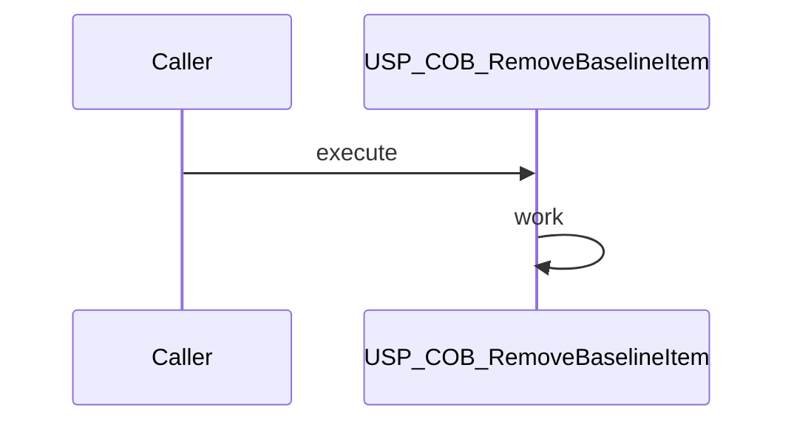
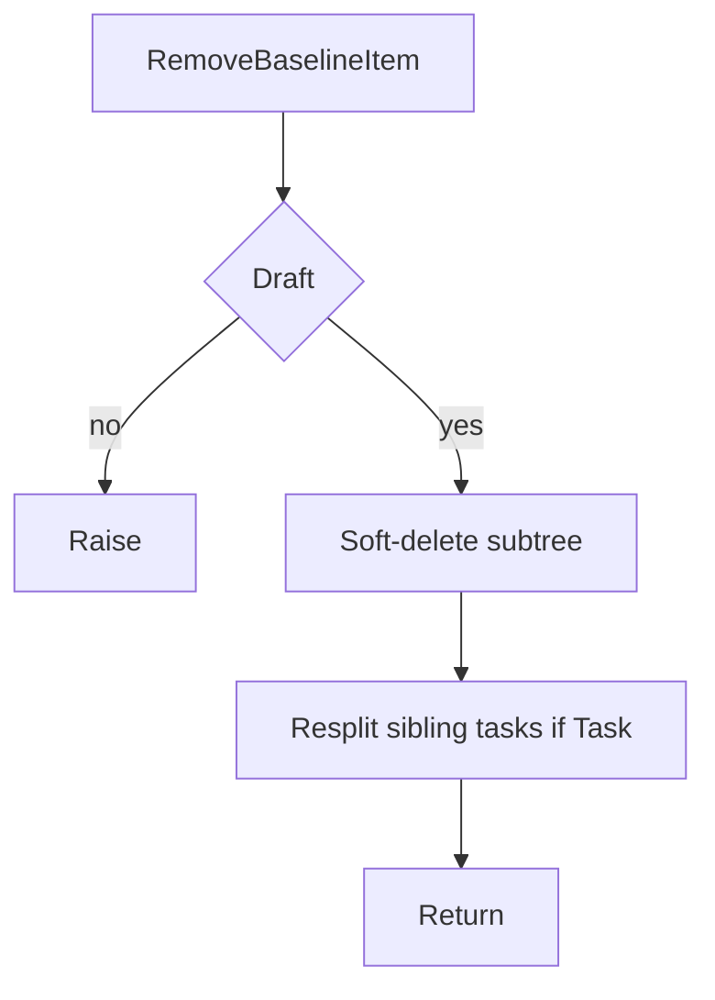

# USP_COB_RemoveBaselineItem

## What it does

Soft-deletes a Draft item and its descendants (IsRemoved=1). Removing a Task re-splits sibling Task weights under that Activity; Module/Section/Activity removals cascade without weight redistribution.

## Parameters

| Name | Direction | What it is for |
|---|---|---|
| `@BaselineItemId` | in | Root of subtree to remove |
| `@UpdatedBy` | in | Actor |

## Call sequence

Calls no other procedures or functions.

## Callers

Procedures and functions that call this object.

No other procedure or function calls this object. App callers are listed in the Plan Templates guide.

## Nested

| Object | Kind | When | Page |
|---|---|---|---|
| *(none)* | — | — | — |

## Steps

1. Refuse unless owning template is Draft.

2. Collect recursive subtree; set IsRemoved=1.

3. When a Task was removed, re-split remaining sibling Task weights under the parent Activity.

## Tables

| Table | Read or write |
|---|---|
| `dbo.TCOB_PlanBaselineItem` | read and write |
| `dbo.TCOB_PlanBaselineTemplate` | read |

## Unresolved calls

None.

## Flow

