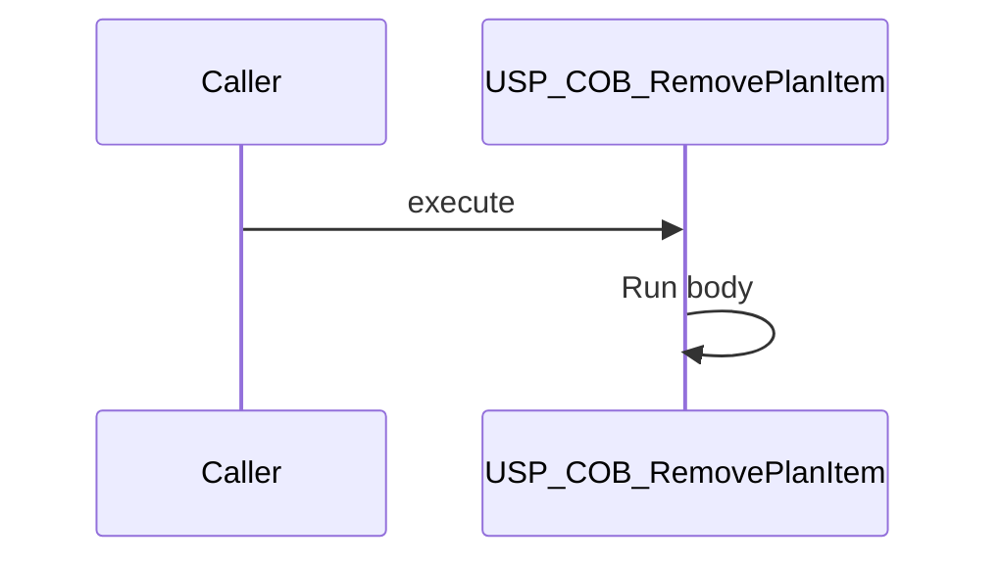
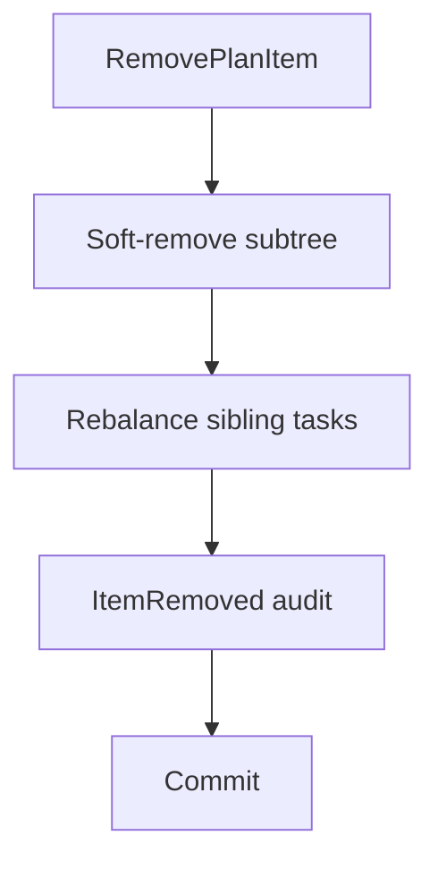

# USP_COB_RemovePlanItem

## What it does

Soft-removes a plan item and its descendants (`IsRemoved = 1`). Removing a Task rebalances remaining sibling weights under the Activity. Logs an ItemRemoved audit entry.

## Parameters

| Name | Direction | What it is for |
|---|---|---|
| `@PlanItemId` | in | Item to remove |
| `@UpdatedBy` | in | Actor |

## Call sequence

Calls no other procedures or functions.

## Callers

Procedures and functions that call this object.

No other procedure or function calls this object. Application caller: Core Node `PlannerAuditDAL.removePlanItem` via `DELETE /api/clientonboard2/plan/item/:id`.

## Nested

Calls no other procedures or functions.

## Steps

1. Locate the item; raise COB_NOT_FOUND when missing or already removed.

2. Snapshot activity total when removing a Task.

3. Soft-remove the item subtree and rebalance remaining siblings.

4. Insert ItemRemoved audit.

## Tables

| Table | Read or write |
|---|---|
| `TCOB_CustomerPlanItem` | read and write |
| `TCOB_CustomerPlan` | read |
| `TCOB_AuditTrail` | write |

## Unresolved calls

None.

## Flow

