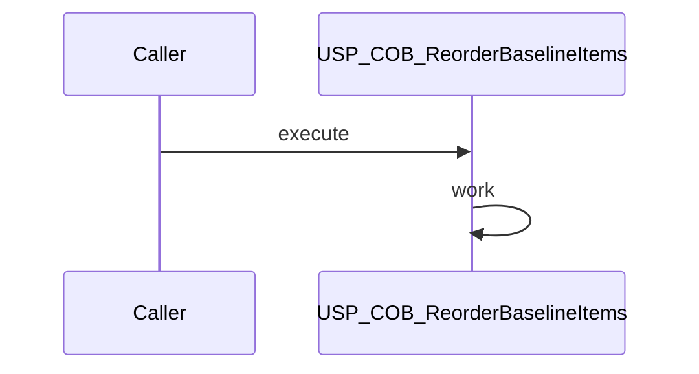
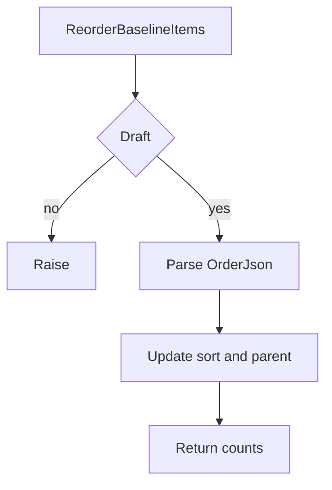

# USP_COB_ReorderBaselineItems

## What it does

Bulk updates SortOrder (and optional ParentItemId) on Draft items from JSON. Enforces level parent rules and refuses cycles. Ids outside the template are ignored.

## Parameters

| Name | Direction | What it is for |
|---|---|---|
| `@BaselineTemplateId` | in | Draft template |
| `@OrderJson` | in | Array of BaselineItemId SortOrder optional ParentItemId |
| `@UpdatedBy` | in | Actor |

## Call sequence

Calls no other procedures or functions.

## Callers

Procedures and functions that call this object.

No other procedure or function calls this object. App callers are listed in the Plan Templates guide.

## Nested

| Object | Kind | When | Page |
|---|---|---|---|
| *(none)* | — | — | — |

## Steps

1. Validate JSON and Draft status.

2. Parse order payload; update SortOrder and optional ParentItemId with level and cycle guards.

3. Return updated and ignored counts.

## Tables

| Table | Read or write |
|---|---|
| `dbo.TCOB_PlanBaselineTemplate` | read |
| `dbo.TCOB_PlanBaselineItem` | read and write |

## Unresolved calls

None.

## Flow

