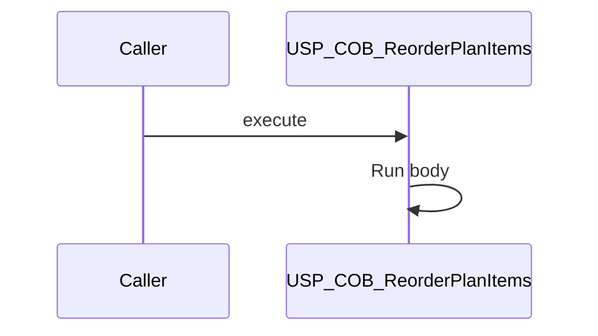
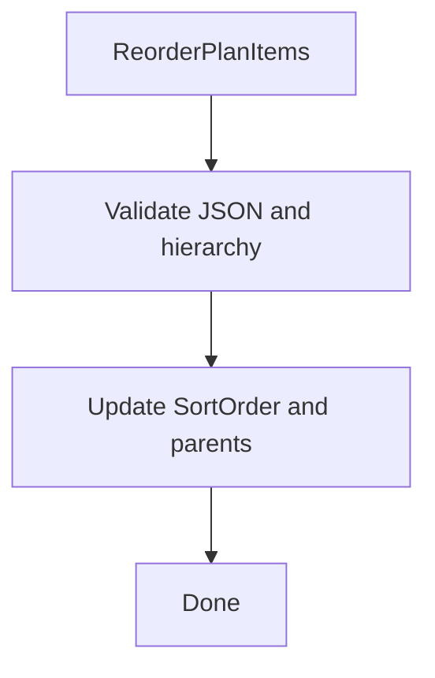

# USP_COB_ReorderPlanItems

## What it does

Applies SortOrder (and optional ParentPlanItemId) from a JSON payload. Enforces hierarchy level rules and refuses cycles that would detach a subtree from the plan root.

## Parameters

| Name | Direction | What it is for |
|---|---|---|
| `@CustomerPlanId` | in | Plan |
| `@OrderJson` | in | JSON array of PlanItemId, SortOrder, optional ParentPlanItemId |
| `@UpdatedBy` | in | Actor |

## Call sequence

Calls no other procedures or functions.

## Callers

Procedures and functions that call this object.

No other procedure or function calls this object. Application caller: Core Node `PlannerAuditDAL.reorderPlanItems` via `PUT /api/clientonboard2/plan/item/reorder`.

## Nested

Calls no other procedures or functions.

## Steps

1. Validate plan id and JSON payload.

2. Enforce level rules and cycle checks for any reparent.

3. Update SortOrder / ParentPlanItemId for listed items.

## Tables

| Table | Read or write |
|---|---|
| `TCOB_CustomerPlan` | read |
| `TCOB_CustomerPlanItem` | read and write |

## Unresolved calls

None.

## Flow

