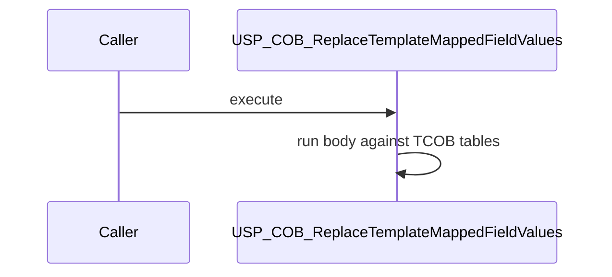
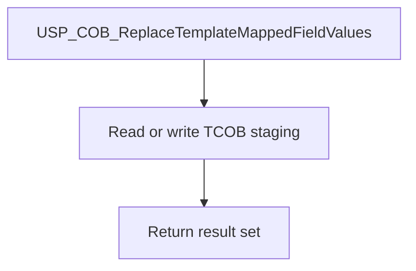

# USP_COB_ReplaceTemplateMappedFieldValues

## What it does

Deletes and re-inserts mapped field values for selected sections of an Import Management request, and clears related process section values / validation results so remapping can restart cleanly.

## Parameters

| Name | Direction | What it is for |
|---|---|---|
| `@FieldValueInfo` | in | Required input |
| `@CreatedBy` | in | Required input |
| `@RequestID` | in | Optional; default NULL |
| `@SectionIds` | in | Optional; default NULL |

## Call sequence

Calls no other procedures or functions.

## Callers

Procedures and functions that call this object.

No other procedure or function calls this object. App caller: `ClientOnboardingDAL.replaceTemplateMappedFieldValues` from Import Management (`POST /api/clientonboard2/replaceTemplateMappedFieldValues`).

## Nested

| Object | Kind | When | Page |
|---|---|---|---|
| *(none)* | — | — | — |

## Steps

1. Parse @FieldValueInfo / @SectionIds for the request.

2. Delete affected TCOB_TemplateMappingFieldValues (and related process values / validation rows as scripted).

3. Insert replacement field-value rows.

4. Stamp CreatedBy from @CreatedBy.

## Tables

| Table | Read or write |
|---|---|
| `dbo.TCOB_TemplateMappingFieldValues` | read or write |
| `dbo.TCOB_ProcessSectionValues` | read or write |
| `dbo.TCOB_TemplateMappingFields` | read or write |
| `dbo.TCOB_ProcessSectionValidationResults` | read or write |

## Unresolved calls

None.

## Flow

