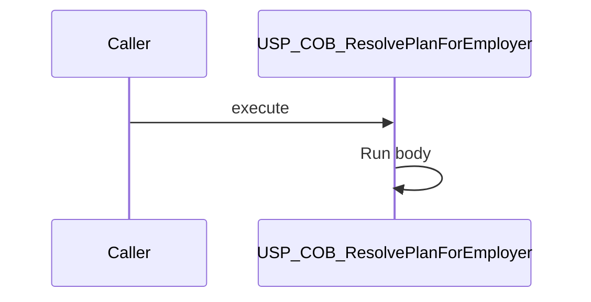
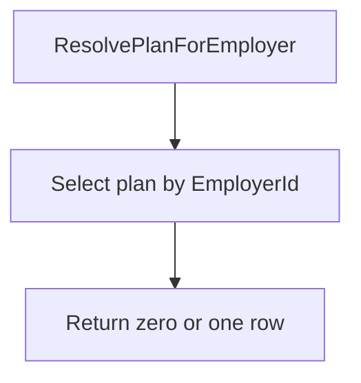

# USP_COB_ResolvePlanForEmployer

## What it does

Cheap existence check for an organisation's own customer plan. Returns CustomerPlanId, EmployerId, and RootEmployerId when present so instantiate can skip a license read.

## Parameters

| Name | Direction | What it is for |
|---|---|---|
| `@EmployerId` | in | Organisation to resolve |

## Call sequence

Calls no other procedures or functions.

## Callers

Procedures and functions that call this object.

No other procedure or function calls this object. Application caller: Core Node `PlannerAuditDAL.resolvePlanForEmployer` from `PlannerAuditBLL.instantiatePlan`.

## Nested

Calls no other procedures or functions.

## Steps

1. Select the plan row for `@EmployerId` from `TCOB_CustomerPlan`.

## Tables

| Table | Read or write |
|---|---|
| `TCOB_CustomerPlan` | read |

## Unresolved calls

None.

## Flow

