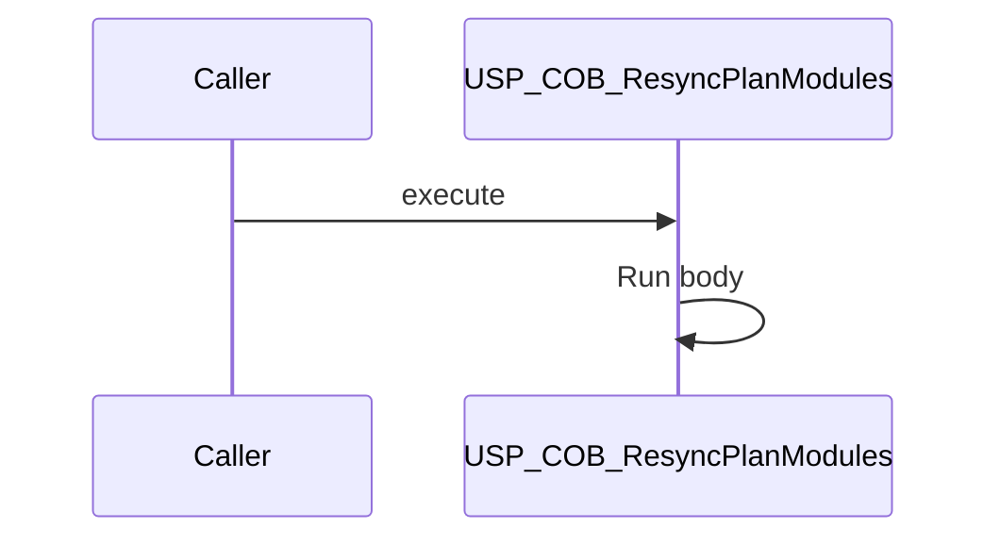
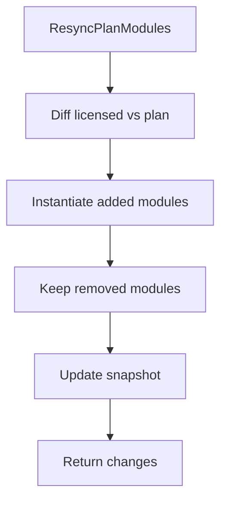

# USP_COB_ResyncPlanModules

## What it does

Re-syncs a customer plan to the current licensed module CSV. Newly licensed modules are instantiated from the baseline; removed modules are kept (append-only) and reported. Updates LicenseSnapshotJson and returns Added/Removed change rows.

## Parameters

| Name | Direction | What it is for |
|---|---|---|
| `@EmployerId` | in | Organisation |
| `@LicensedModuleIdsCsv` | in | Current licensed module ids |
| `@LicenseSnapshotJson` | in | Snapshot to store |
| `@UpdatedBy` | in | Actor |

## Call sequence

Calls no other procedures or functions.

## Callers

Procedures and functions that call this object.

No other procedure or function calls this object. Application caller: Core Node `PlannerAuditDAL.resyncPlanModules` via `POST /api/clientonboard2/plan/resync`.

## Nested

Calls no other procedures or functions.

## Steps

1. Locate the employer's plan; raise COB_NOT_FOUND when missing.

2. Diff licensed modules vs plan snapshot / baseline.

3. Insert baseline items for added modules; flag removed modules without deleting work.

4. Update snapshot and return change rows.

## Tables

| Table | Read or write |
|---|---|
| `TCOB_CustomerPlan` | read and write |
| `TCOB_CustomerPlanItem` | read and write |
| `TCOB_PlanBaselineItem` | read |
| `TCOB_AuditTrail` | write |

## Unresolved calls

None.

## Flow

