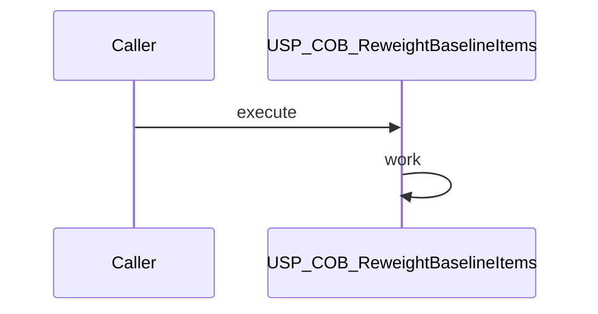
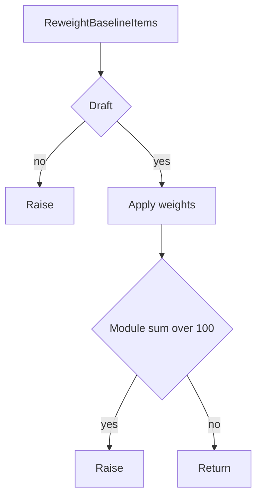

# USP_COB_ReweightBaselineItems

## What it does

Bulk writes Task Weightage from JSON on a Draft. Non-task ids are ignored. HoldActivityTotal (despite the name) holds or caps the MODULE-wide Task total at 100 with proportional sibling rescale rules.

## Parameters

| Name | Direction | What it is for |
|---|---|---|
| `@BaselineTemplateId` | in | Draft template |
| `@WeightsJson` | in | Array of BaselineItemId Weightage |
| `@HoldActivityTotal` | in | 1 hold module total; 0 leave room until over 100 |
| `@UpdatedBy` | in | Actor |

## Call sequence

Calls no other procedures or functions.

## Callers

Procedures and functions that call this object.

No other procedure or function calls this object. App callers are listed in the Plan Templates guide.

## Nested

| Object | Kind | When | Page |
|---|---|---|---|
| *(none)* | — | — | — |

## Steps

1. Validate Draft and JSON; ignore non-Task ids.

2. Apply weights; rescale untouched siblings per HoldActivityTotal / module-cap rules.

3. Refuse if any module Task sum would exceed 100 after the batch.

## Tables

| Table | Read or write |
|---|---|
| `dbo.TCOB_PlanBaselineTemplate` | read |
| `dbo.TCOB_PlanBaselineItem` | read and write |

## Unresolved calls

None.

## Flow

