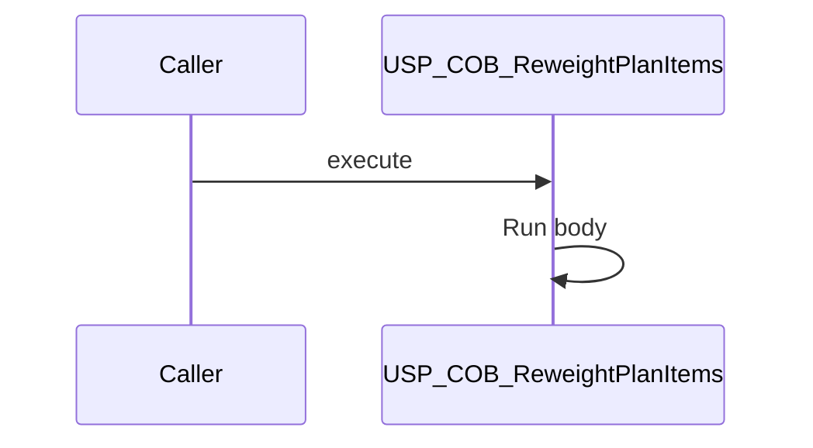
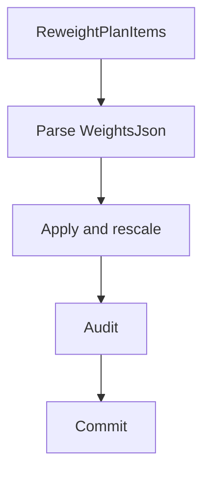

# USP_COB_ReweightPlanItems

## What it does

Bulk-reweights plan items from a JSON array. `@HoldActivityTotal` 1 keeps an Activity total fixed by rescaling untouched siblings; 0 uses module-wide rules capped at 100. Raises COB_WEIGHT_OVER_100 / COB_NOT_FOUND as needed.

## Parameters

| Name | Direction | What it is for |
|---|---|---|
| `@CustomerPlanId` | in | Plan |
| `@WeightsJson` | in | JSON array of PlanItemId and Weightage |
| `@HoldActivityTotal` | in | 1 keep activity total; 0 module-wide |
| `@UpdatedBy` | in | Actor |

## Call sequence

Calls no other procedures or functions.

## Callers

Procedures and functions that call this object.

No other procedure or function calls this object. Application caller: Core Node `PlannerAuditDAL.reweightPlanItems` via `PUT /api/clientonboard2/plan/item/reweight`.

## Nested

Calls no other procedures or functions.

## Steps

1. Parse JSON edits and reject invalid weights.

2. Apply new weights and rescale untouched siblings per mode.

3. Persist updates and write change-log entries.

## Tables

| Table | Read or write |
|---|---|
| `TCOB_CustomerPlan` | read |
| `TCOB_CustomerPlanItem` | read and write |
| `TCOB_AuditTrail` | write |

## Unresolved calls

None.

## Flow

