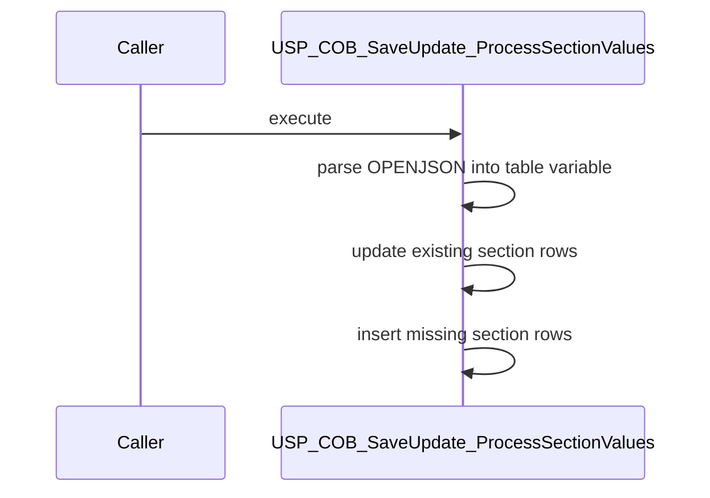
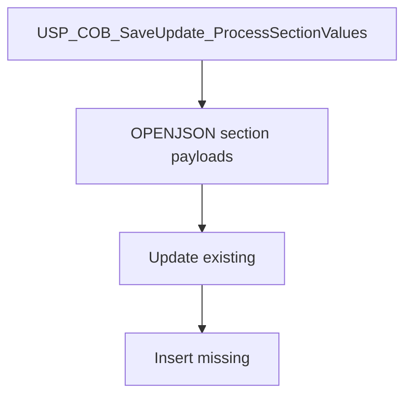

# USP_COB_SaveUpdate_ProcessSectionValues

## What it does

Upserts staged process-section JSON for one COB2 upload request. `@SectionValue` is a JSON array of objects with `sectionId` and `isValid`. Existing `TCOB_ProcessSectionValues` rows for those sections are updated; missing sections are inserted. Returns error code 0 on success.

## Parameters

| Name | Direction | What it is for |
|---|---|---|
| `@RequestID` | in | Upload request that owns the section rows |
| `@SectionValue` | in | JSON array of section payloads |
| `@CreatedBy` | in | Actor for insert / update audit columns |

## Call sequence

Calls no other procedures or functions.

## Callers

Procedures and functions that call this object.

No other procedure or function calls this object. App caller: `ClientOnboardingDAL` save path from Import Management COB2 API (`POST /api/clientonboard2/saveUpdateProcessSectionValues`).

## Nested

| Object | Kind | When | Page |
|---|---|---|---|
| *(none)* | — | — | — |

## Steps

1. Script is `HRMS-DATABASE/HRMS/STOREPROCEDURE/USP_COB_SaveUpdate_ProcessSectionValues.sql`.
2. Parse `@SectionValue` with `OPENJSON` into a table variable (`sectionId`, value JSON, `isValid`).
3. Update matching `TCOB_ProcessSectionValues` rows for `@RequestID`.
4. Insert rows for section ids that do not yet exist on the request.
5. Return `ErrorCode = 0`.

## Tables

| Table | Read or write |
|---|---|
| `dbo.TCOB_ProcessSectionValues` | read, write |

## Unresolved calls

None. Parsing uses `OPENJSON` / `JSON_VALUE` (built-ins).

## Flow

