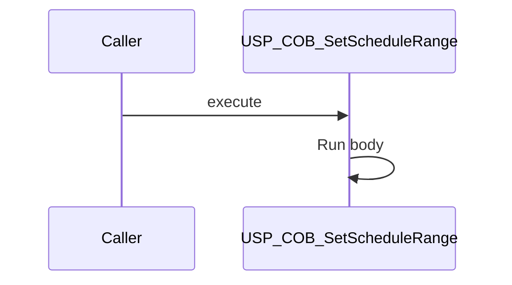
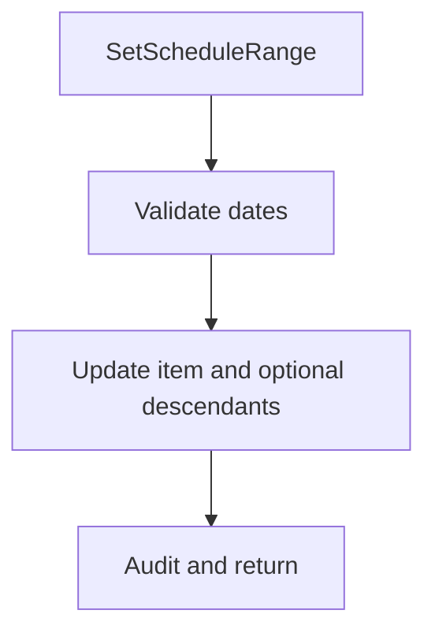

# USP_COB_SetScheduleRange

## What it does

Sets one item's planned start/end and optionally cascades the same window to all non-removed descendants. Does not touch status, percent, or actual dates. No per-row RowVersion check.

## Parameters

| Name | Direction | What it is for |
|---|---|---|
| `@PlanItemId` | in | Root item |
| `@PlannedStart` / `@PlannedEnd` | in | Window |
| `@Cascade` | in | Also update descendants |
| `@UpdatedBy` | in | Actor |

## Call sequence

Calls no other procedures or functions.

## Callers

Procedures and functions that call this object.

No other procedure or function calls this object. Application caller: Core Node `PlannerAuditDAL.setScheduleRange` via `PUT /api/clientonboard2/plan/schedule/range`.

## Nested

Calls no other procedures or functions.

## Steps

1. Validate planned dates.

2. Update the item and optionally its descendant tree.

3. Write schedule audit and return affected count.

## Tables

| Table | Read or write |
|---|---|
| `TCOB_CustomerPlanItem` | read and write |
| `TCOB_CustomerPlan` | read |
| `TCOB_AuditTrail` | write |

## Unresolved calls

None.

## Flow

