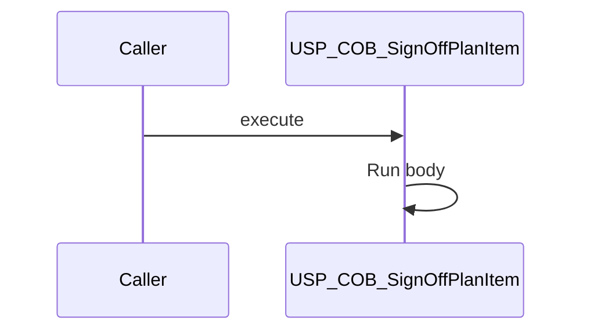
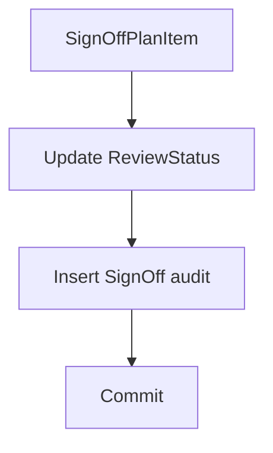

# USP_COB_SignOffPlanItem

## What it does

Marks one plan item `ReviewStatus` as SignedOff with optimistic concurrency, and inserts a SignOff audit row with FieldName ReviewStatus.

## Parameters

| Name | Direction | What it is for |
|---|---|---|
| `@PlanItemId` | in | Item to sign off |
| `@RowVersion` | in | Optimistic concurrency stamp |
| `@ReviewerRemarks` | in | Reviewer remarks |
| `@ReviewedBy` | in | Reviewer employee id |

## Call sequence

Calls no other procedures or functions.

## Callers

Procedures and functions that call this object.

No other procedure or function calls this object. Application caller: Core Node `PlannerAuditDAL.signOffPlanItem` via `POST /api/clientonboard2/plan/item/signoff`.

## Nested

Calls no other procedures or functions.

## Steps

1. Load item and plan employer; raise COB_NOT_FOUND when missing.

2. Update ReviewStatus to SignedOff when RowVersion matches; else COB_CONFLICT.

3. Insert TCOB_AuditTrail SignOff row and commit.

## Tables

| Table | Read or write |
|---|---|
| `TCOB_CustomerPlanItem` | read and write |
| `TCOB_CustomerPlan` | read |
| `TCOB_AuditTrail` | write |

## Unresolved calls

None.

## Flow

