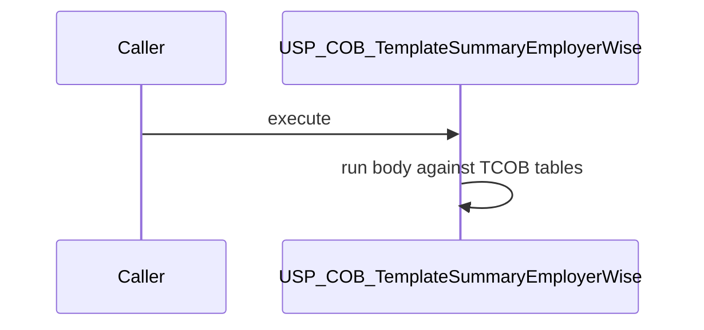
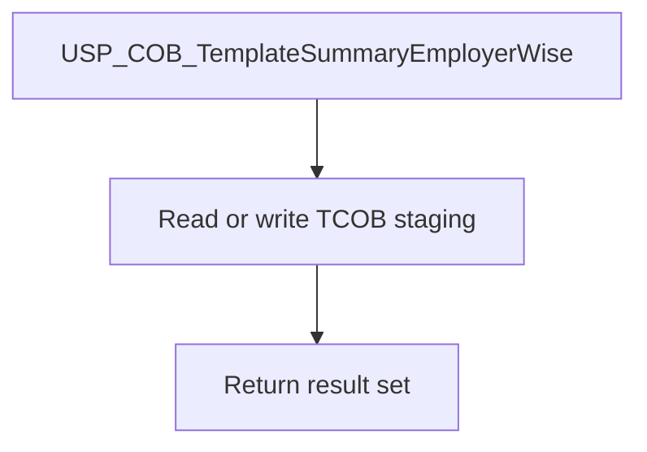

# USP_COB_TemplateSummaryEmployerWise

## What it does

Lists active Import Management upload requests for one employer with template name, wizard steps, section counts, uploaded sheet counts, and mapped field-value counts.

## Parameters

| Name | Direction | What it is for |
|---|---|---|
| `@EmployerID` | in | Optional; default NULL |

## Call sequence

Calls no other procedures or functions.

## Callers

Procedures and functions that call this object.

No other procedure or function calls this object. App caller: `ClientOnboardingDAL.getTemplateSummaryEmployerWise` from Import Management (`GET /api/clientonboard2/getTemplateSummaryEmployerWise`).

## Nested

| Object | Kind | When | Page |
|---|---|---|---|
| *(none)* | — | — | — |

## Steps

1. Select from TCOB_TemplateUploadRequest joined to template, sections, status, sheets, mapping fields, and field values.

2. Filter IsActive = 1 and EmployerID = @EmployerID.

3. Group and order by RequestID descending.

## Tables

| Table | Read or write |
|---|---|
| `dbo.TCOB_TemplateUploadRequest` | read or write |
| `dbo.TCOB_TemplateMaster` | read or write |
| `dbo.TCOB_TemplateSectionMaster` | read or write |
| `dbo.TCOB_TemplateStatus` | read or write |
| `dbo.TCOB_TemplateSheetDetails` | read or write |
| `dbo.TCOB_TemplateMappingFields` | read or write |
| `dbo.TCOB_TemplateMappingFieldValues` | read or write |

## Unresolved calls

None.

## Flow

