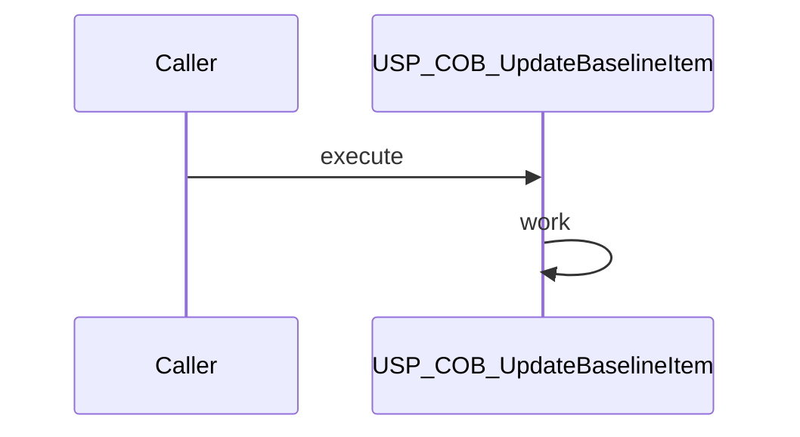
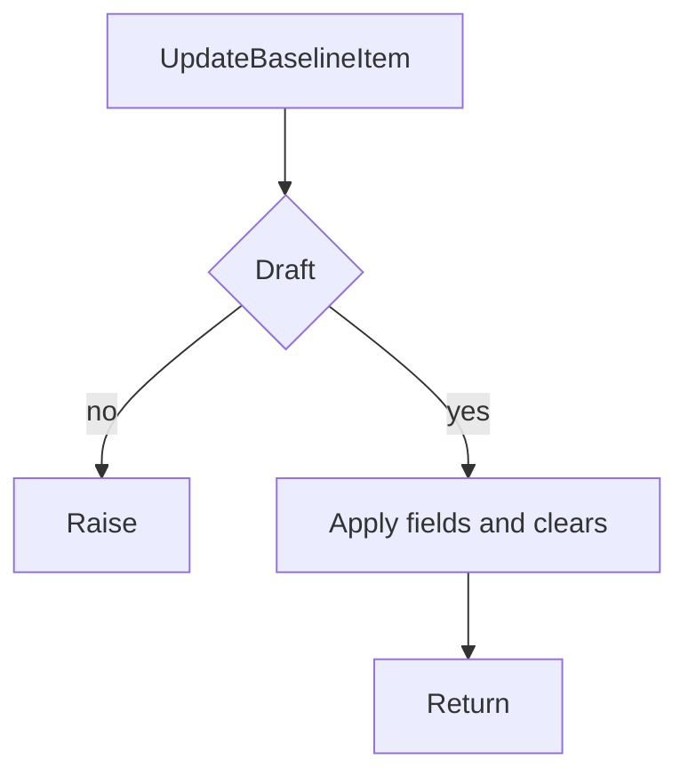

# USP_COB_UpdateBaselineItem

## What it does

Field-edits one Draft baseline item. NULL means leave alone; Clear flags blank optional columns. Does not change Weightage, SortOrder, ModuleId, Level, or Parent.

## Parameters

| Name | Direction | What it is for |
|---|---|---|
| `@BaselineItemId` | in | Item to edit |
| `@RowVersion` | in | Optional concurrency |
| `@Name` | in | Optional new name |
| `@HrmsNavPath` | in | Optional |
| `@SectionName` | in | Activity only |
| `@DefaultEffortHrs` | in | Optional |
| `@DefaultDurationDays` | in | Optional |
| `@IsMandatory` | in | Optional |
| `@IsAutoTracked` | in | Optional |
| `@TemplateId` | in | Optional |
| `@ClearNavPath` | in | Blank HrmsNavPath |
| `@ClearSectionName` | in | Blank SectionName |
| `@ClearEffortHrs` | in | Blank effort |
| `@ClearDurationDays` | in | Blank duration |
| `@UpdatedBy` | in | Actor |

## Call sequence

Calls no other procedures or functions.

## Callers

Procedures and functions that call this object.

No other procedure or function calls this object. App callers are listed in the Plan Templates guide.

## Nested

| Object | Kind | When | Page |
|---|---|---|---|
| *(none)* | — | — | — |

## Steps

1. Load item and template; refuse non-Draft and RowVersion conflicts.

2. Apply provided fields and Clear flags; constrain SectionName to Activity.

3. Return updated row metadata.

## Tables

| Table | Read or write |
|---|---|
| `dbo.TCOB_PlanBaselineItem` | read and write |
| `dbo.TCOB_PlanBaselineTemplate` | read |

## Unresolved calls

None.

## Flow

