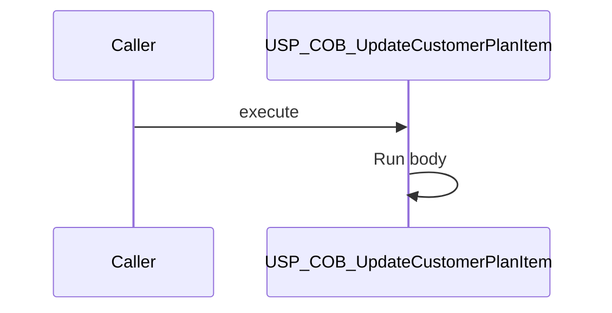
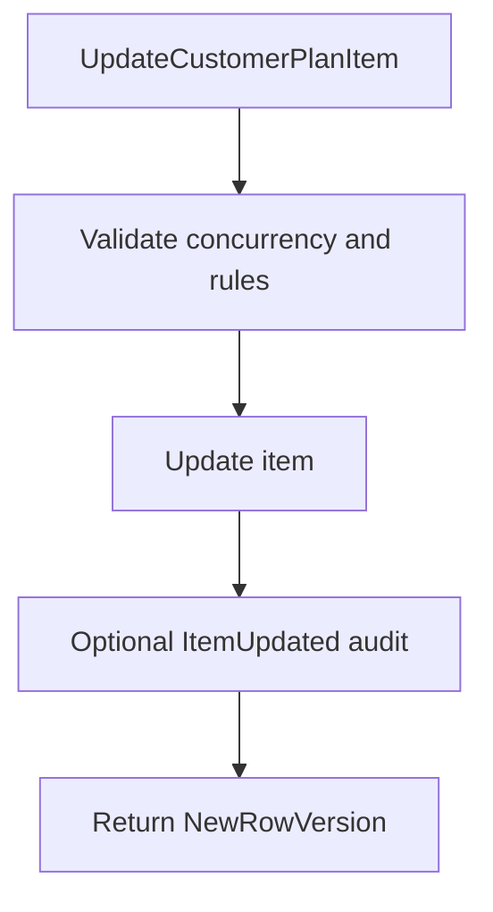

# USP_COB_UpdateCustomerPlanItem

## What it does

Manually updates one plan item with optimistic concurrency (`RowVersion`). Enforces schedule and delay rules (`COB_*` RAISERROR). Optionally inserts a generic `ItemUpdated` audit row. Returns the new `RowVersion`.

## Parameters

| Name | Direction | What it is for |
|---|---|---|
| `@PlanItemId` | in | Item to update |
| `@RowVersion` | in | Optimistic concurrency stamp |
| `@Status` | in | Task status |
| `@PercentComplete` | in | Percent complete |
| `@ActualStart` / `@ActualEnd` | in | Actual dates |
| `@IsNA` | in | Not-applicable flag |
| `@DelayCategoryId` | in | Delay reason when overrun |
| `@Remark` / `@ClearRemark` | in | Implementer remarks |
| `@EvidenceLink` | in | Evidence URL for audit |
| `@UpdatedBy` | in | Actor |
| `@SkipGenericAudit` | in | Skip generic ItemUpdated row |
| `@PlannedStart` / `@PlannedEnd` | in | Planned dates (NULL keeps) |
| `@Name` | in | Rename (NULL/blank keeps) |

## Call sequence

Calls no other procedures or functions.

## Callers

Procedures and functions that call this object.

No other procedure or function calls this object. Application caller: Core Node `PlannerAuditDAL.updateCustomerPlanItem` via `PUT /api/clientonboard2/plan/item`.

## Nested

Calls no other procedures or functions.

## Steps

1. Load current item values and validate existence and `RowVersion`.

2. Validate planned/actual schedule and delay-category rules.

3. In a transaction, update `TCOB_CustomerPlanItem` and optionally insert `TCOB_AuditTrail` `ItemUpdated`.

4. Return `NewRowVersion`.

## Tables

| Table | Read or write |
|---|---|
| `TCOB_CustomerPlanItem` | read and write |
| `TCOB_CustomerPlan` | read |
| `TCOB_AuditTrail` | write |

## Unresolved calls

None.

## Flow

