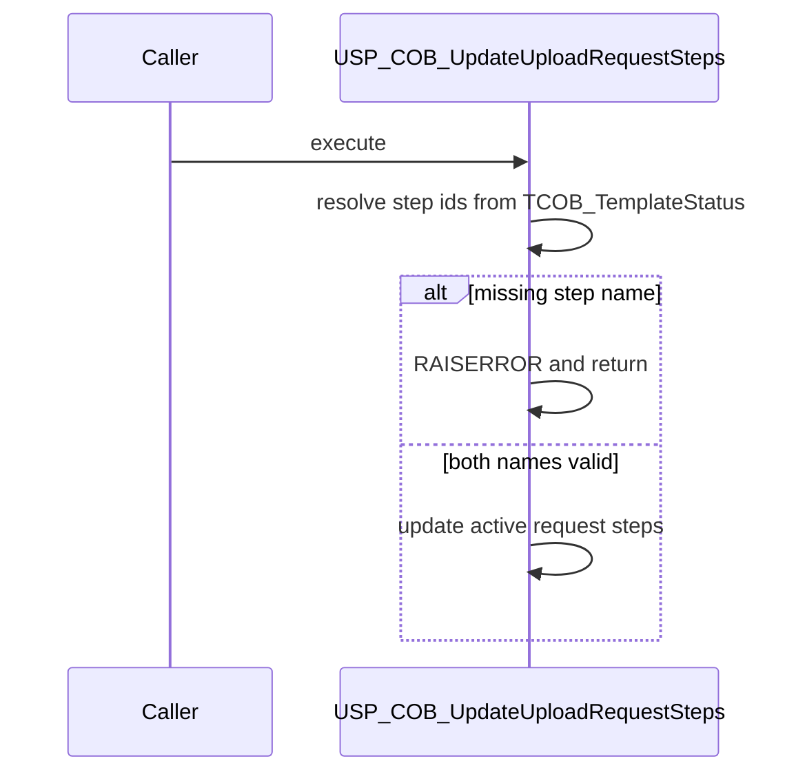
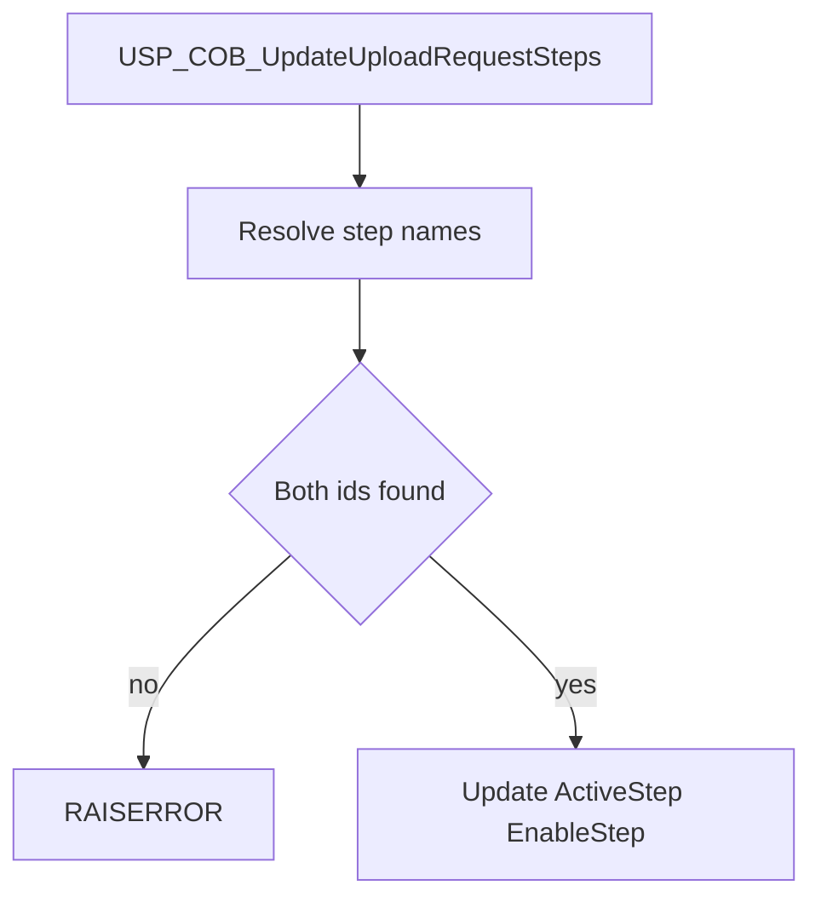

# USP_COB_UpdateUploadRequestSteps

## What it does

Advances the wizard steps on one active COB2 upload request. It resolves `@ActiveStepName` and `@EnableStepName` to ids in `TCOB_TemplateStatus`, then updates `ActiveStep`, `EnableStep`, `UpdatedBy`, and `UpdatedDate` on the matching active `TCOB_TemplateUploadRequest` row. Invalid step names raise an error and leave the row unchanged.

## Parameters

| Name | Direction | What it is for |
|---|---|---|
| `@RequestID` | in | Upload request to update |
| `@ActiveStepName` | in | Current step display name |
| `@EnableStepName` | in | Highest enabled step display name |
| `@CreatedBy` | in | Actor stored as `UpdatedBy` |

## Call sequence

Calls no other procedures or functions.

## Callers

Procedures and functions that call this object.

No other procedure or function calls this object. App caller: `ClientOnboardingDAL.updateUploadRequestSteps` from Import Management COB2 API (`POST /api/clientonboard2/updateUploadRequestSteps`).

## Nested

| Object | Kind | When | Page |
|---|---|---|---|
| *(none)* | — | — | — |

## Steps

1. Script is `HRMS-DATABASE/HRMS/STOREPROCEDURE/USP_COB_UpdateUploadRequestSteps.sql`.
2. Look up `@ActiveStepID` and `@EnableStepID` from `TCOB_TemplateStatus` by name.
3. `RAISERROR` and return when either id is null.
4. `UPDATE` the active `TCOB_TemplateUploadRequest` for `@RequestID` with the new step ids and audit columns.

## Tables

| Table | Read or write |
|---|---|
| `dbo.TCOB_TemplateStatus` | read |
| `dbo.TCOB_TemplateUploadRequest` | write |

## Unresolved calls

None.

## Flow

