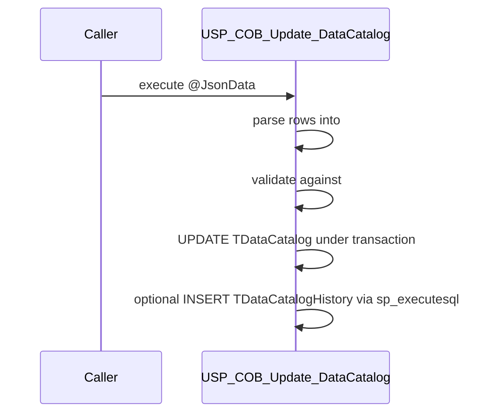
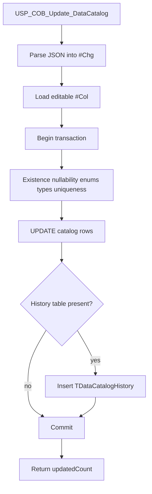

# USP_COB_Update_DataCatalog

## What it does

Applies a JSON batch of cell edits to `dbo.TDataCatalog` in one all-or-nothing transaction. Column names are resolved from `sys.columns` at run time (QUOTENAME only after a metadata match); values are never concatenated into SQL. Rejects invalid batches with THROW 50001–50007. When `dbo.TDataCatalogHistory` exists with `IsSchemaChange`, writes one history snapshot per actually updated CatalogId (`IsSchemaChange = 0`). Returns `updatedCount`.

## Parameters

| Name | Direction | What it is for |
|---|---|---|
| `@JsonData` | in | JSON `{ "rows": [ { "catalogId": n, "changes": { "<Column>": value } } ] }` |

## Call sequence

Calls no other procedures or functions (only `sys.sp_executesql`).

## Callers

Procedures and functions that call this object.

No other procedure or function calls this object. App callers: `ClientOnboardingDAL.updateDataCatalog` → `PUT /api/clientonboard2/data-catalog`, and AI submit after `USP_COB_POST_DataCatalogAISuggestionStatus`.

## Nested

| Object | Kind | When | Page |
|---|---|---|---|
| *(none)* | — | — | — |

## Steps

1. `SET NOCOUNT ON`; `SET XACT_ABORT ON`. Reject when `@JsonData` is not JSON (50001).

2. Parse `$.rows` / `$.changes` into `#Chg`. Reject empty batches or duplicate CatalogId+ColumnName pairs (50001).

3. Load `#Col` from `sys.columns` / `sys.types` with type declaration, length, nullability, and `Editable` (CatalogId / CreateDate / UpdatedDate, identity, computed, user-defined types are not editable).

4. Reject unknown or non-editable columns (50002).

5. `BEGIN TRAN`. Under `UPDLOCK, HOLDLOCK`, reject missing CatalogId (50003). Normalize empty strings to NULL for non-character or nullable character columns. Reject NULL/empty on NOT NULL columns (50005). Enforce fixed lists for `UsageStatus`, `TableType`, `COBDatasetInFlowType` (50006).

6. Per distinct column, dynamic `TRY_CONVERT` / length / round-trip checks (50004).

7. If DatabaseName or TableName changes, ensure the final DatabaseName + TableName pair stays unique across rows (50007); allow in-batch swaps.

8. UPDATE DatabaseName/TableName together when either changes; then cursor of dynamic UPDATEs for other columns. Collect touched ids into `#UpdatedIds`. Set `UpdatedDate = GETDATE()`.

9. When `TDataCatalogHistory` exists with `IsSchemaChange` and `#UpdatedIds` is non-empty, dynamic INSERT of matching non-computed columns plus `IsSchemaChange = 0`.

10. `COMMIT`. Select `COUNT(DISTINCT CatalogId)` from `#UpdatedIds` as `updatedCount`.

## Tables

| Table | Read or write |
|---|---|
| `dbo.TDataCatalog` | read + write |
| `dbo.TDataCatalogHistory` | write (when present) |
| `sys.columns` | read |
| `sys.types` | read |
| `#Chg`, `#Col`, `#UpdatedIds` | temp |

## Unresolved calls

| Call | Notes |
|---|---|
| `sys.sp_executesql` | Per-column type checks, per-column UPDATEs, and optional history INSERT; column list follows live `sys.columns` |

## Flow

