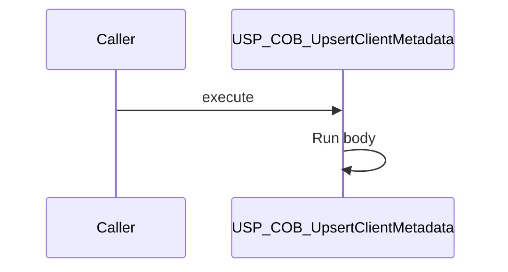
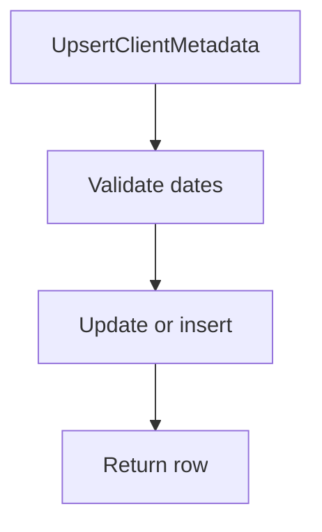

# USP_COB_UpsertClientMetadata

## What it does

Creates or updates one organisation's `TCOB_ClientImplementationMetadata` row. Raises COB_BAD_METADATA_SCHEDULE when go-live is earlier than project start. Returns the saved row.

## Parameters

| Name | Direction | What it is for |
|---|---|---|
| `@EmployerId` | in | Organisation |
| `@ProjectStartDate` / `@GoLiveDate` | in | Project dates |
| `@ProjectManager` / `@SalesPerson` / `@ImplementedBy` | in | People fields |
| `@ClientUrl` / `@CompanyCode` | in | URL and code |
| `@UpdatedBy` | in | Actor |

## Call sequence

Calls no other procedures or functions.

## Callers

Procedures and functions that call this object.

No other procedure or function calls this object. Application caller: Core Node `PlannerAuditDAL.upsertClientMetadata` via `POST /api/clientonboard2/plan/metadata`.

## Nested

Calls no other procedures or functions.

## Steps

1. Validate go-live vs project start.

2. UPDATE existing metadata row or INSERT a new one.

3. Return the saved metadata columns.

## Tables

| Table | Read or write |
|---|---|
| `TCOB_ClientImplementationMetadata` | read and write |

## Unresolved calls

None.

## Flow

