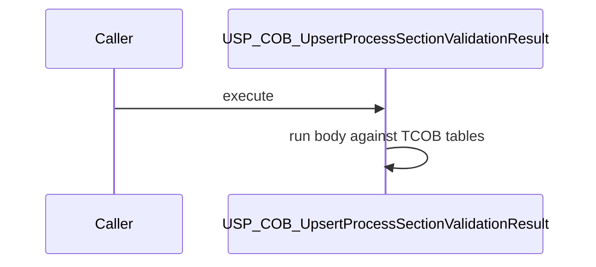
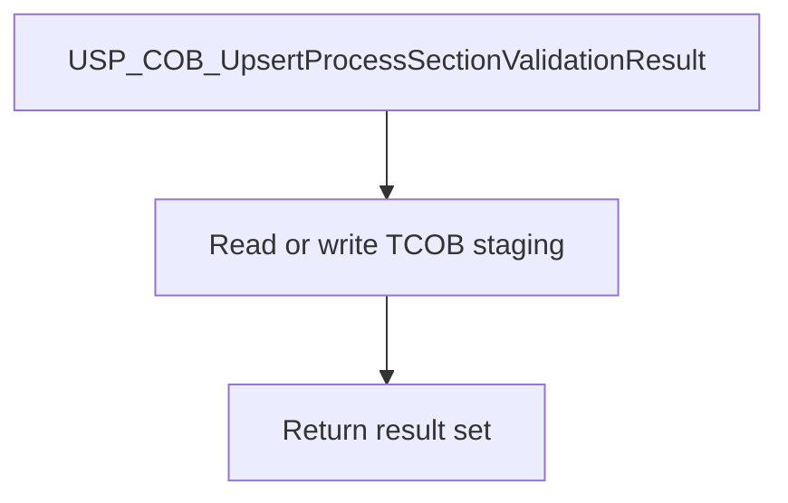

# USP_COB_UpsertProcessSectionValidationResult

## What it does

Upserts one Import Management section validation result. Updates TCOB_ProcessSectionValidationResults when RequestID+SectionID exists; otherwise inserts Valid/Invalid/Duplicate counts and Result JSON.

## Parameters

| Name | Direction | What it is for |
|---|---|---|
| `@RequestID` | in | Required input |
| `@SectionID` | in | Required input |
| `@Result` | in | Optional; default NULL |
| `@EmployeeID` | in | Optional; default NULL |
| `@Isvalid` | in | Optional; default NULL |
| `@ValidCount` | in | Optional; default NULL |
| `@InvalidCount` | in | Optional; default NULL |
| `@DuplicateCount` | in | Optional; default NULL |

## Call sequence

Calls no other procedures or functions.

## Callers

Procedures and functions that call this object.

No other procedure or function calls this object. App caller: `ClientOnboardingDAL.upsertProcessSectionValidationResult` from Import Management (`POST /api/clientonboard2/upsertProcessSectionValidationResult`).

## Nested

| Object | Kind | When | Page |
|---|---|---|---|
| *(none)* | — | — | — |

## Steps

1. UPDATE the validation row for @RequestID and @SectionID when present.

2. When no row was updated, INSERT a new validation result with counts and Result.

3. Stamp UpdatedBy/CreatedBy from @EmployeeID.

## Tables

| Table | Read or write |
|---|---|
| *(none detected in script joins)* | — |

## Unresolved calls

None.

## Flow

