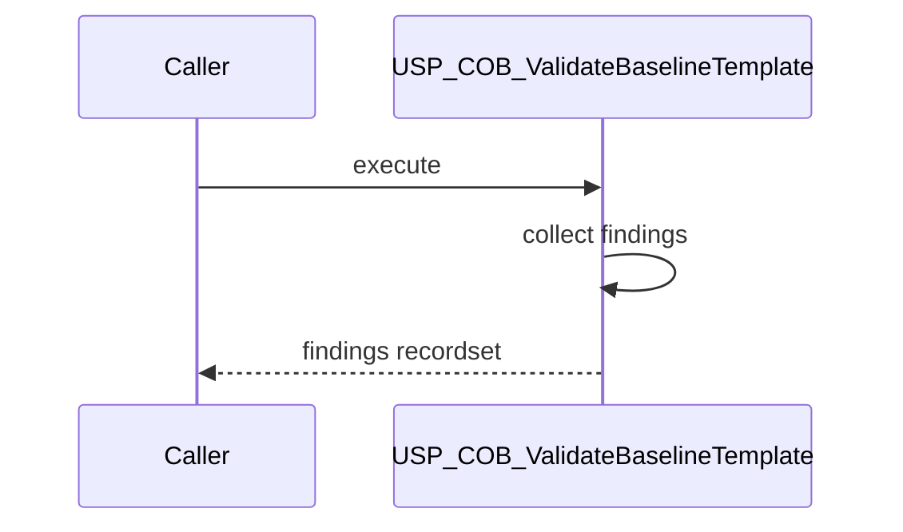
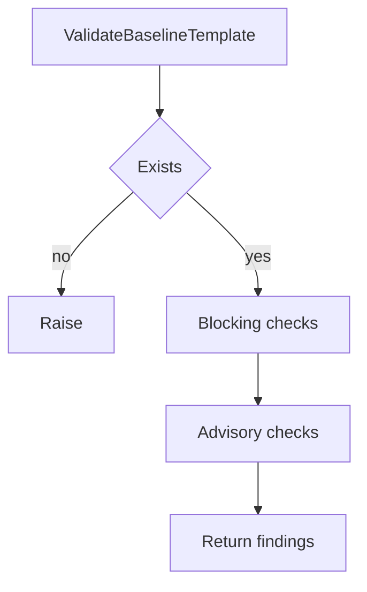

# USP_COB_ValidateBaselineTemplate

## What it does

Read-only pre-publish findings (Blocking and Advisory) for one baseline. Single definition of publish rules; Publish consumes the same result set via INSERT EXEC.

## Parameters

| Name | Direction | What it is for |
|---|---|---|
| `@BaselineTemplateId` | in | Template to validate |

## Call sequence

Calls no other procedures or functions.

## Callers

Procedures and functions that call this object.

| Object | Kind | Page |
|---|---|---|
| `USP_COB_PublishBaselineTemplate` | procedure | [USP_COB_PublishBaselineTemplate](/docs/database/hrms/USP_COB_PublishBaselineTemplate) |

## Nested

| Object | Kind | When | Page |
|---|---|---|---|
| *(none)* | — | — | — |

## Steps

1. Validate template exists.

2. Insert Blocking findings (empty template, missing ModuleId, ModuleId mismatch, and related integrity rules).

3. Insert Advisory findings (for example module weight not 100).

4. Return Severity, Code, Message, ItemCount, SampleBaselineItemId.

## Tables

| Table | Read or write |
|---|---|
| `dbo.TCOB_PlanBaselineTemplate` | read |
| `dbo.TCOB_PlanBaselineItem` | read |

## Unresolved calls

None.

## Flow

