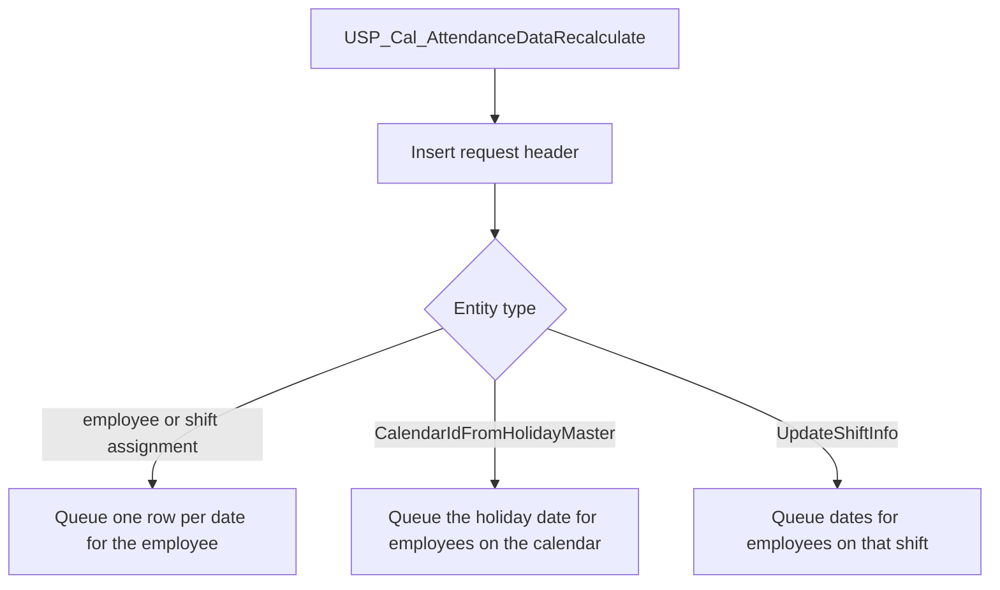

# USP_Cal_AttendanceDataRecalculate

## What it does

Queues an attendance rebuild. It always inserts a header in `tAttendanceDataRecalculateRequest`. The detail rows depend on `@pvEntityType`. A compulsory holiday from Setup Masters passes `CalendarIdFromHolidayMaster`, the calendar id, and the holiday date as both from and to.

## Parameters

| Name | Direction | What it is for |
|---|---|---|
| `@pvEmployerID` | in | Organisation |
| `@pvEntityID` | in | Employee, calendar, or shift id, depending on entity type |
| `@pvEntityType` | in | Which rebuild branch to run |
| `@pvFromDate` | in | First date. Nullable |
| `@pvToDate` | in | Last date |
| `@pvLoginUserID` | in | User recorded as created-by |

All parameters are inputs.

## Call sequence

Calls no other procedures or functions.

## Callers

| Object | Kind | Page |
|---|---|---|
| `SP_AdminAM_UpdShift` | procedure | No page yet |
| `SP_AdminMstr_AddHoliday` | procedure | [SP_AdminMstr_AddHoliday](/docs/database/hrms/SP_AdminMstr_AddHoliday) |
| `SP_AdminMstr_DelHolidayById` | procedure | No page yet |
| `SP_AdminMstr_UpdHoliday` | procedure | No page yet |
| `SP_BulkProfile_UpdateEmployeeOfficialInformation` | procedure | No page yet |
| `SP_Bulk_Create_Activate_Employee` | procedure | No page yet |
| `SP_EC_UpdateEmployeeOfficialInformation` | procedure | No page yet |
| `SP_EC_UpdateEmployeeOfficialInformation_240624` | procedure | No page yet |
| `SP_Mydetails_Enhanced_UpdateEmployeeOfficialInformation` | procedure | No page yet |
| `USP_AssignShiftBasedOnARTime` | procedure | No page yet |
| `USP_Roster_Process_AllTimeNo` | procedure | No page yet |
| `USP_Roster_Process_AllTimeYes` | procedure | No page yet |
| `USP_Roster_Process_Delta` | procedure | No page yet |
| `USP_Roster_Process_Template` | procedure | No page yet |
| `USP_Roster_Save` | procedure | No page yet |
| `USP_Roster_UpdateEmployeeRoster` | procedure | No page yet |
| `USP_Update_ManageRoaster` | procedure | No page yet |

## Nested

Calls no other procedures or functions.

## Steps

1. Insert `tAttendanceDataRecalculateRequest` and keep `SCOPE_IDENTITY()` (`USP_Cal_AttendanceDataRecalculate.sql`).
2. When `@pvEntityType` is `Update_ManageRoaster`, `EmployeeUpdate`, `ARApproved_AssignShift`, or `ProcessLatePunchData_AssignShift`, treat `@pvEntityID` as an employee. `EmployeeUpdate` also copies and deletes `TEmployeeDayWiseAttendanceStatus` from `@pvFromDate` onward. Insert one unprocessed `tAttendanceDataRecalculateRequestDetail` per date from `@pvFromDate` through `@pvToDate`, not past today, skipping dates that already have an unprocessed row.
3. When `@pvEntityType` is `CalendarIdFromHolidayMaster`, load employees whose `TEmployeeInfo.Calendarid` is `@pvEntityID`. Delete `TEmployeeDayWiseAttendanceStatus` for `@pvFromDate`. If that date is today or later, delete zero-minute `tDailyRegisterNew` rows for the date and queue details for employees who already have processed minutes. If the date is in the past, queue one detail per employee on the calendar unless an unprocessed row already exists. A further insert queues details for employees who have processed minutes on that date.
4. When `@pvEntityType` is `UpdateShiftInfo`, build dates from `@pvFromDate` to `@pvToDate`. If the employer does not show the shift roster, the employees are active people whose `ShiftType` is `@pvEntityID`. If the roster is shown, the employees come from the active shift-group roster for that shift. Insert detail rows that are not already queued unprocessed.

## Tables

| Table | Read or write |
|---|---|
| `tAttendanceDataRecalculateRequest` | write |
| `tAttendanceDataRecalculateRequestDetail` | read and write |
| `TEmployeeDayWiseAttendanceStatus` | read and write, for `EmployeeUpdate` and `CalendarIdFromHolidayMaster` |
| `TEmployeeDayWiseAttendanceStatus_History` | write, for `EmployeeUpdate` |
| `TEmployeeInfo` | read |
| `tDailyRegisterNew` | read and write, for a current or future holiday date |
| `tCustomerSettings` | read, for `UpdateShiftInfo` |
| `tEmployee` | read, for `UpdateShiftInfo` |
| `TSHIFTGROUPMASTER` | read, when the shift roster is shown |
| `TShiftGroupMapping` | read, when the shift roster is shown |
| `TEmployeeRoaster` | read, when the shift roster is shown |

## Flow

