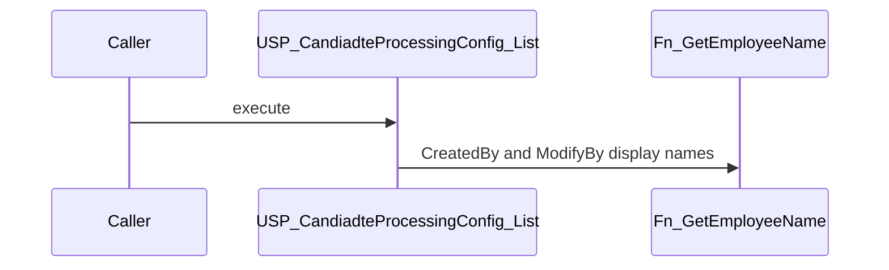
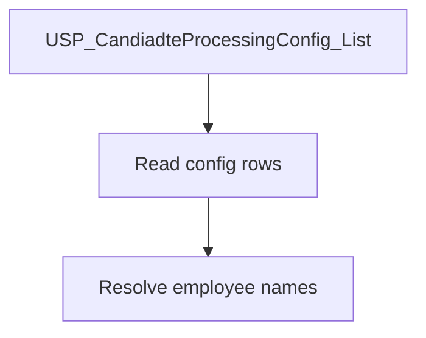

# USP_CandiadteProcessingConfig_List

## What it does

Returns candidate-processing configuration rows for an employer, with formatted dates and creator or modifier display names. Optionally filters to one config id.

## Parameters

| Name | Direction | What it is for |
|---|---|---|
| `@EmployerID` | in | Employer whose rows are listed |
| `@candiadteProcessingConfigID` | in | Optional single config id |

## Call sequence

## Callers

No other procedure or function calls this object.

## Nested

| Object | Kind | When | Page |
|---|---|---|---|
| `Fn_GetEmployeeName` | function | for CreatedBy and ModifyBy | [Fn_GetEmployeeName](/docs/database/hrms/Fn_GetEmployeeName) |

## Steps

1. Select config columns from `TcandiadteProcessingConfig` for `@EmployerID`, optionally filtered by `@candiadteProcessingConfigID`.
2. Resolve CreatedBy and ModifyBy through `Fn_GetEmployeeName` and format date columns.

## Tables

| Table | Read or write |
|---|---|
| `TcandiadteProcessingConfig` | read |

## Flow

