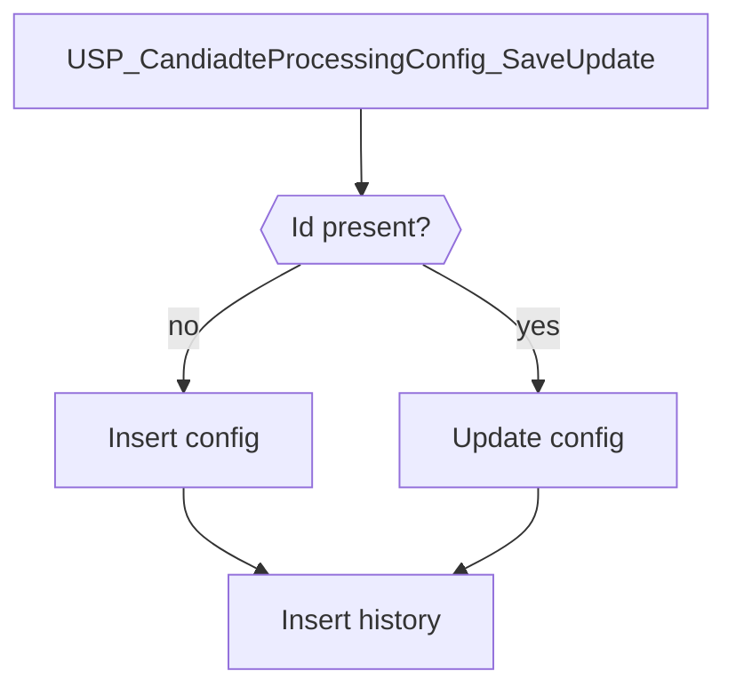

# USP_CandiadteProcessingConfig_SaveUpdate

## What it does

Inserts or updates one employer candidate-processing configuration row, then writes a history row.

## Parameters

| Name | Direction | What it is for |
|---|---|---|
| `@candiadteProcessingConfigID` | in | Existing id, or 0 or null to insert |
| `@EmployerID` | in | Employer |
| `@IsCandidateInfoTemplate` | in | Candidate-info template flag |
| `@IsOfferAcceptanceTemplate` | in | Offer-acceptance template flag |
| `@ISautomaticPreOnboardinglink` | in | Automatic link flag |
| `@CreatedBy` | in | Creator on insert |
| `@ModifyBy` | in | Modifier on update |
| `@OfferValidTillDays` | in | Offer validity days |
| `@ReviewMandatory` | in | Review-mandatory flag |

## Call sequence

Calls no other procedures or functions.

## Callers

No other procedure or function calls this object.

## Nested

Calls no other procedures or functions.

## Steps

1. When `@candiadteProcessingConfigID` is null or 0, insert into `TcandiadteProcessingConfig` and capture the new id.
2. Otherwise update the existing row and set `@CreatedBy` to `@ModifyBy` for history.
3. Insert a matching row into `TcandiadteProcessingConfigHistory`.

## Tables

| Table | Read or write |
|---|---|
| `TcandiadteProcessingConfig` | write |
| `TcandiadteProcessingConfigHistory` | write |

## Flow

