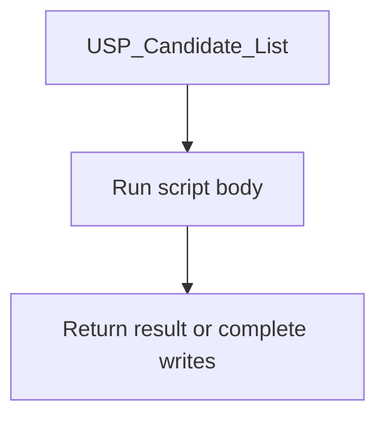

# USP_Candidate_List

## What it does

Returns candidates available for the email-communication picker.

## Parameters

| Name | Direction | What it is for |
|---|---|---|
| `@Employerid` | in | INT |

## Call sequence

Calls no other procedures or functions.

## Callers

Application callers include Core API `preOnBoardingDAL` methods used by **Employee Management → Pre-Onboarding Candidate** (`PreOnboardCandidate.aspx`). Search HRMS `STOREPROCEDURE/` and `FUNCTIONS/` for additional `EXEC`/`dbo.` callers when extending this page.

## Nested

Calls no other procedures or functions.

## Steps

From `HRMS-DATABASE/HRMS/STOREPROCEDURE/USP_Candidate_List.sql`:

1. See script body for ordered statements.

## Tables

| Table | Read or write |
|---|---|
| `dbo.POBCandidate` | read |

## Flow

