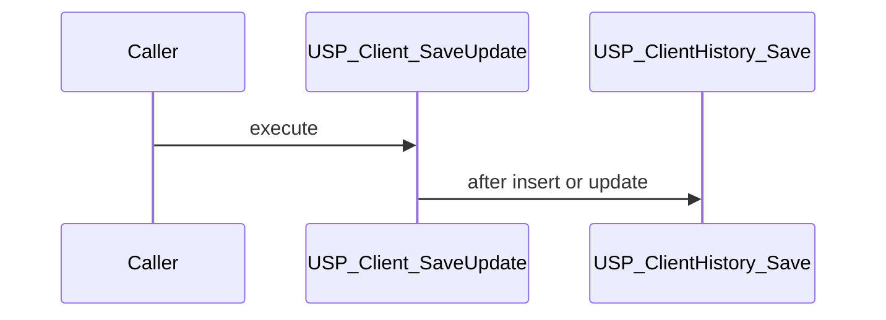
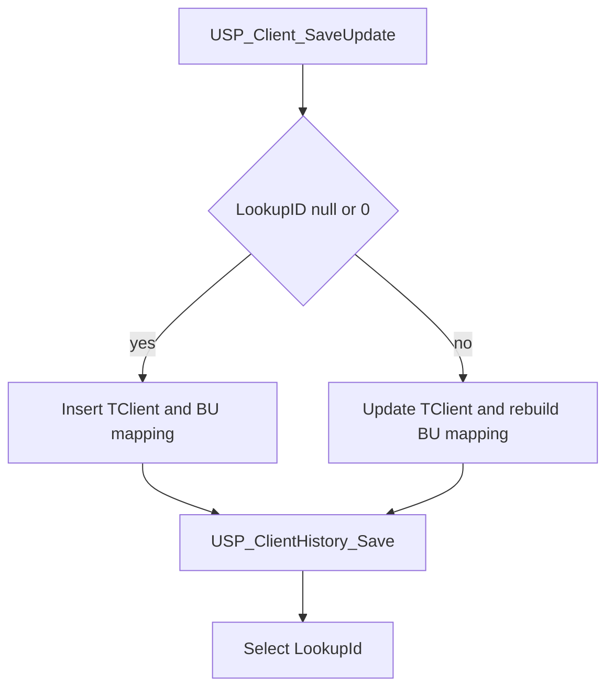

# USP_Client_SaveUpdate

## What it does

Inserts or updates a `TClient` master row and rebuilds `TClientBusinessUnitMapping` from the comma-separated `@LookupBUs` list. Always ends by writing a `TClientHistory` snapshot through `USP_ClientHistory_Save` and returning `LookupId` (`ClientID`).

## Parameters

| Name | Direction | What it is for |
|---|---|---|
| `@LookupID` | in | Client id; 0/null means insert |
| `@LookupText` | in | Client name |
| `@LookupParentId` | in | Expected client parent (100) from caller |
| `@LookupBUs` | in | Comma-separated business unit ids |
| `@SubParentId` | in | Sub-parent id stored on the client |
| `@pEmployerid` | in | Employer |
| `@AdditionalInfo` | in | Extra text |
| `@CreatedBy` | in | Actor |

## Call sequence

## Callers

Procedures and functions that call this object.

| Object | Kind | Page |
|---|---|---|
| `Sp_RA_InsertUpdate_TLookup` | procedure | [Sp_RA_InsertUpdate_TLookup](/docs/database/hrms-resourceallocation/Sp_RA_InsertUpdate_TLookup) |

Also reachable from Resource Allocation via synonym `ResourceAllocation.dbo.USP_Client_SaveUpdate`.

## Nested

| Object | Kind | When | Page |
|---|---|---|---|
| `USP_ClientHistory_Save` | procedure | after every successful save | [USP_ClientHistory_Save](/docs/database/hrms/USP_ClientHistory_Save) |

## Steps

1. Script is `HRMS-DATABASE/HRMS/STOREPROCEDURE/USP_Client_SaveUpdate.sql`.
2. If `@LookupID` is 0/null, insert `TClient` and insert BU mapping rows from `STRING_SPLIT(@LookupBUs)`.
3. Else update `TClient`, soft-delete existing BU mappings, and re-insert from `@LookupBUs` (or soft-delete all mappings when BUs are empty).
4. `EXEC USP_ClientHistory_Save` for the client id.
5. Select `@ClientID AS LookupId`.

## Tables

| Table | Read or write |
|---|---|
| `dbo.TClient` | write |
| `dbo.TClientBusinessUnitMapping` | write |
| `dbo.TClientHistory` | write via nested save |

## Flow

