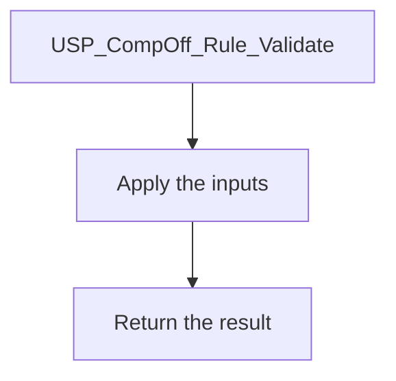

# USP_CompOff_Rule_Validate

## What it does

Validates a compensatory-off rule before save.

## Parameters

| Name | Direction | What it is for |
|---|---|---|
| `@CompOffRuleID` | in | `INT` |
| `@CompOffRuleName` | in | `NVARCHAR(200)` |
| `@LeaveTransactionId` | in | `INT` |
| `@LeaveCode` | in | `CHAR(4)` |
| `@IsStandardRule` | in | `BIT` |
| `@EffectiveDate` | in | `DATE` |
| `@RoundingRule` | in | `VARCHAR(20)` |
| `@IsActive` | in | `BIT` |
| `@EmployerID` | in | `INT` |
| `@CreatedBy` | in | `INT` |
| `@ApplicableOnData` | in | `UDT_CompOffRuleApplicableOn` |
| `@MappingParameterData` | in | `UDT_CompOffRuleMappingParameterWithValues` |
| `@ActionType` | in | `VARCHAR(20)` |

## Call sequence

Calls no other procedures or functions.

## Callers

No other procedure or function calls this object.

## Nested

Calls no other procedures or functions.

## Steps

In `HRMS-DATABASE/HRMS/STOREPROCEDURE/USP_CompOff_Rule_Validate.sql`:
1. Accept the declared parameters and run the procedure or function body.
3. Read or write the tables listed under Tables.
4. Return result sets, scalar values, or status as defined in the script.

## Tables

| Table | Read or write |
|---|---|
| `TCompOffRule` | read or write |
| `TCompOffRuleMappingParameter` | read or write |
| `TCompOffRuleMappingParameterValue` | read or write |

## Flow

