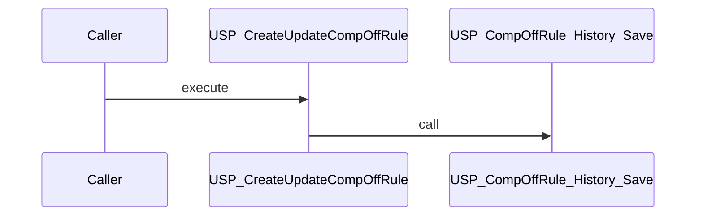
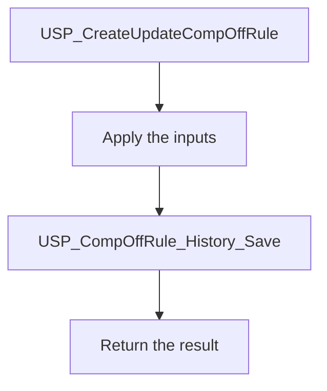

# USP_CreateUpdateCompOffRule

## What it does

Creates or updates a compensatory-off credit rule for Create Comp-Off Rules.

## Parameters

| Name | Direction | What it is for |
|---|---|---|
| `@CompOffRuleID` | in | `INT` |
| `@CompOffRuleName` | in | `NVARCHAR(200)` |
| `@LeaveTransactionId` | in | `INT` |
| `@LeaveCode` | in | `CHAR(4)` |
| `@IsStandardRule` | in | `BIT` |
| `@EffectiveDate` | in | `DATE` |
| `@RoundingRule` | in | `VARCHAR(20)` |
| `@IsActive` | in | `BIT` |
| `@EmployerID` | in | `INT` |
| `@CreatedBy` | in | `INT` |
| `@ApplicableOnData` | in | `UDT_CompOffRuleApplicableOn` |
| `@MappingParameterData` | in | `UDT_CompOffRuleMappingParameterWithValues` |
| `@ActionType` | in | `VARCHAR(20)` |
| `@IsPreferStandard` | in | `BIT` |

## Call sequence

## Callers

No other procedure or function calls this object.

## Nested

| Object | Kind | When | Page |
|---|---|---|---|
| `USP_CompOffRule_History_Save` | procedure | Called while this object runs | No page yet |

## Steps

In `HRMS-DATABASE/HRMS/STOREPROCEDURE/USP_CreateUpdateCompOffRule.sql`:
1. Accept the declared parameters and run the procedure or function body.
2. Call nested objects listed under Nested when their guarding branches are true.
3. Read or write the tables listed under Tables.
4. Return result sets, scalar values, or status as defined in the script.

## Tables

| Table | Read or write |
|---|---|
| `TComp_OffRequestByEmployee` | read or write |
| `TCompOffPreference` | read or write |
| `TCompOffPreferenceHistory` | read or write |
| `TCompOffRule` | read or write |
| `TCompOffRuleApplicableOn` | read or write |
| `TCompOffRuleMappingParameter` | read or write |
| `TCompOffRuleMappingParameterValue` | read or write |

## Flow

