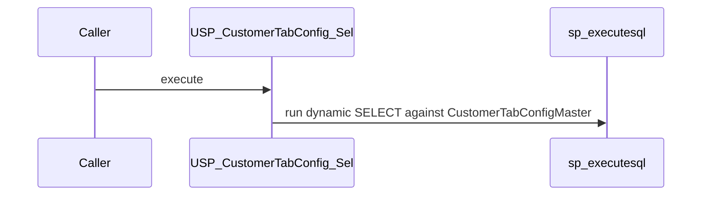
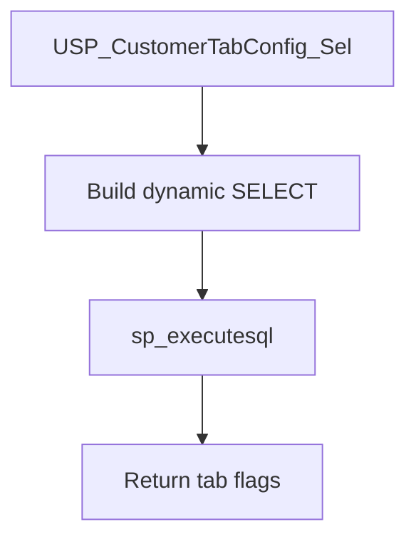

# USP_CustomerTabConfig_Sel

## What it does

Returns which Customer Config host tabs are enabled for one employer (or every employer when `@EmployerID` is null). Customer Config uses it on page load to build the scrollable tab strip.

## Parameters

| Name | Direction | What it is for |
|---|---|---|
| `@EmployerID` | in | Employer to filter. Null returns every row |

## Call sequence

## Callers

No other procedure or function calls this object. `dashBoardDAL.GetCustomerTabConfigs` executes it from Customer Config.

## Nested

| Object | Kind | When | Page |
|---|---|---|---|
| `sp_executesql` | system | run the dynamic SELECT | n/a |

## Steps

1. In `HRMS-DATABASE/HRMS/STOREPROCEDURE/USP_CustomerTabConfig_Sel.sql`, build a dynamic SELECT of tab flags from `CustomerTabConfigMaster` joined to `TEmployerDetails` for `custid`.
2. Filter with `@EmployerID IS NULL OR c.EmployerID = @EmployerID`.
3. Execute the batch with `sp_executesql`.

## Tables

| Table | Read or write |
|---|---|
| `dbo.CustomerTabConfigMaster` | read |
| `dbo.TEmployerDetails` | read |

## Flow

