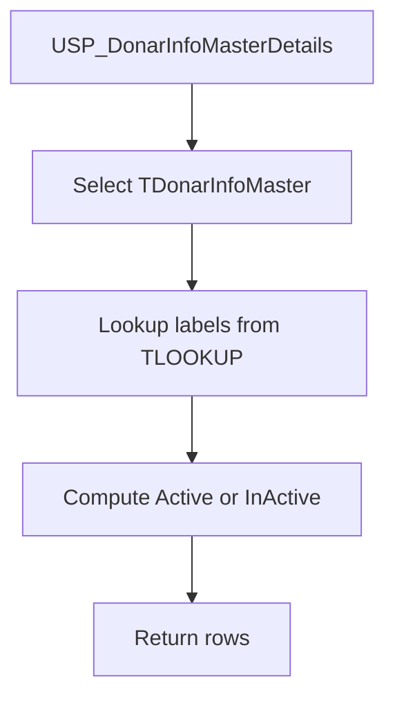

# USP_DonarInfoMasterDetails

## What it does

Returns non-deleted donor master rows for an employer, with donor type / source / currency labels from `TLOOKUP` and a computed `IsActive` of `Active` only when the bit is set and today falls between grant start and end dates.

## Parameters

| Name | Direction | What it is for |
|---|---|---|
| `@EmployeeId` | in | Accepted; not used in the WHERE clause |
| `@EmployerId` | in | Filter `TDonarInfoMaster.EmployerId` when supplied |

## Call sequence

Calls no other procedures or functions.

## Callers

Application: Donor Information Setup `GetDonarInfo` (`recruitmentDAL.js`). No other procedure or function calls this object.

## Nested

Calls no other procedures or functions.

## Steps

1. Select distinct donor columns from `TDonarInfoMaster` where `IsDeleted = 0` and employer matches when `@EmployerId` is supplied.
2. Resolve `DonarType`, `DonationSource`, and `DonarCurrencyType` via correlated `TLOOKUP` selects.
3. Compute `IsActive` as `Active` or `InActive` from bit + grant date window.
4. Return `IsAttachment = 1` on every row.

## Tables

| Table | Read or write |
|---|---|
| `TDonarInfoMaster` | read |
| `TLOOKUP` | read |

## Unresolved calls

None.

## Flow

