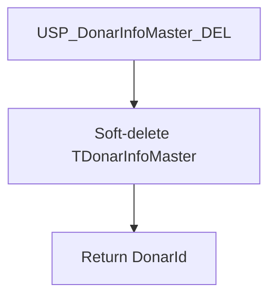

# USP_DonarInfoMaster_DEL

## What it does

Soft-deletes a donor by setting `IsDeleted = 1` and `IsActive = 0` on `TDonarInfoMaster`, stamping `UpdatedBy` / `UpdatedDate`. Returns the `DonarId`.

## Parameters

| Name | Direction | What it is for |
|---|---|---|
| `@DonarId` | in | Donor to soft-delete |
| `@UpdatedBy` | in | Audit user |

## Call sequence

Calls no other procedures or functions.

## Callers

Application: Donor Information Setup `DeleteDonarDetails` (`recruitmentDAL.js`). No other procedure or function calls this object.

## Nested

Calls no other procedures or functions.

## Steps

1. Update `TDonarInfoMaster` set `IsDeleted = 1`, `IsActive = 0`, audit columns where `DonarId = @DonarId`.
2. Select `@DonarId` as `DonarId`.

## Tables

| Table | Read or write |
|---|---|
| `TDonarInfoMaster` | write |

## Unresolved calls

None.

## Flow

