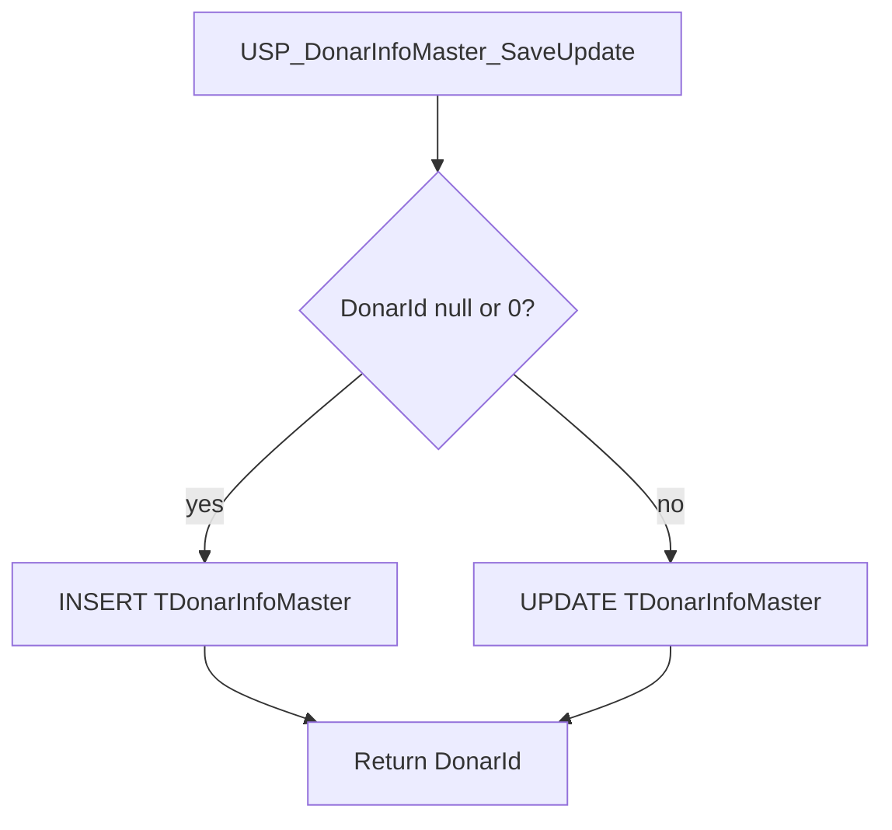

# USP_DonarInfoMaster_SaveUpdate

## What it does

Inserts a new `TDonarInfoMaster` row when `@DonarId` is null/0, otherwise updates the existing donor including `IsActive`, grant amounts, and contact fields. Returns the `DonarId`.

## Parameters

| Name | Direction | What it is for |
|---|---|---|
| `@DonarId` | in | 0/null = insert; else update key |
| `@DonarName` / `@DonarTypeID` / `@DonationSourceId` / `@DonationPurpose` | in | Donor identity and purpose |
| `@DonarCurrencyTypeId` / `@DonorTotalGrant` / `@GrantStartDate` / `@GrantEndDate` | in | Grant envelope |
| `@IsActive` | in | Active bit (applied on update) |
| `@PhoneNumber` / `@Email` / `@Address` | in | Contact |
| `@CreatedBy` / `@UpdatedBy` / `@EmployerId` / `@EmployeeId` | in | Audit and tenant |

## Call sequence

Calls no other procedures or functions.

## Callers

Application: Donor Information Setup `InsertDonarInfo` (`recruitmentDAL.js`). No other procedure or function calls this object.

## Nested

Calls no other procedures or functions.

## Steps

1. If `@DonarId` is null/0, insert into `TDonarInfoMaster` and return `SCOPE_IDENTITY()` as `DonarId`.
2. Else update the matching row (including `IsActive`) and return `@DonarId`.

## Tables

| Table | Read or write |
|---|---|
| `TDonarInfoMaster` | write |

## Unresolved calls

None.

## Flow

