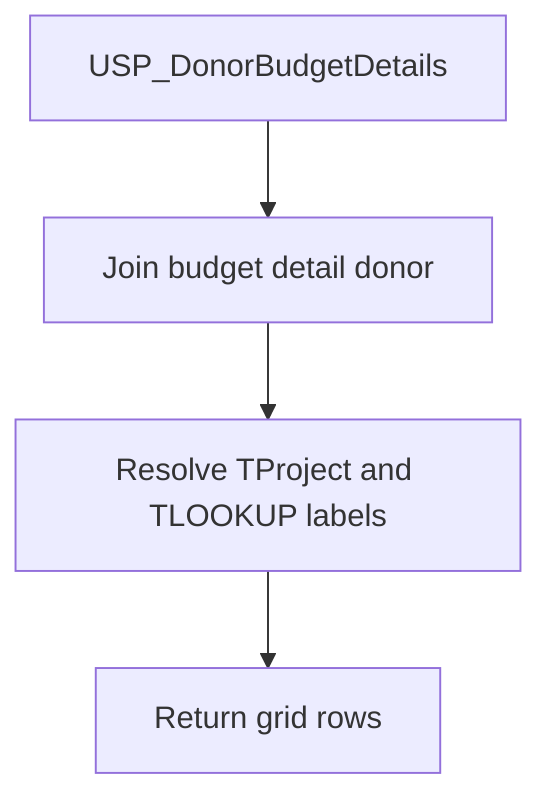

# USP_DonorBudgetDetails

## What it does

Returns the employer’s donor budget grid: each active `TDonorBudgetDetail` joined to its `TDonorBudget` header and donor name, with lookup labels for currency, location, holder, program, and expense nature, and project name from `TProject`.

## Parameters

| Name | Direction | What it is for |
|---|---|---|
| `@EmployerId` | in | Restrict budgets to this employer |

## Call sequence

Calls no other procedures or functions.

## Callers

Application: Donor Information Setup `GetBudgetInfo` (`recruitmentDAL.js`). No other procedure or function calls this object.

## Nested

Calls no other procedures or functions.

## Steps

1. Join `TDonorBudget` to active `TDonorBudgetDetail` and `TDonarInfoMaster` for `@EmployerId`.
2. Resolve project name from `TProject` and label fields from `TLOOKUP`.
3. Compute budget `BudgetStatus` as `Active` when the bit is set and end date is after today.

## Tables

| Table | Read or write |
|---|---|
| `TDonorBudget` | read |
| `TDonorBudgetDetail` | read |
| `TDonarInfoMaster` | read |
| `TProject` | read |
| `TLOOKUP` | read |

## Unresolved calls

None.

## Flow

