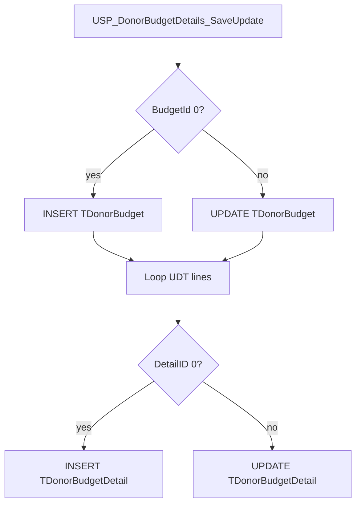

# USP_DonorBudgetDetails_SaveUpdate

## What it does

Inserts or updates a `TDonorBudget` header, then walks the `@DonorBudgetDetail` UDT and inserts or updates each `TDonorBudgetDetail` line. Returns the `BudgetId`.

## Parameters

| Name | Direction | What it is for |
|---|---|---|
| `@DonorBudgetDetail` | in | `UDT_DonorBudgetDetails` line items |
| `@BudgetId` | in | 0/null = insert header; else update |
| `@DonarId` / `@BudgetStatus` / `@BudgetStartDate` / `@BudgetEndDate` | in | Header fields |
| `@ProjectID` / `@AllocatedAmount` / `@AllocatedAmountCurrencyID` | in | Project allocation |
| `@ProjectStartDate` / `@ProjectEndDate` | in | Project window on the budget |
| `@EmployerId` / `@CreatedBy` / `@UpdatedBy` | in | Tenant and audit |

## Call sequence

Calls no other procedures or functions.

## Callers

Application: Donor Information Setup `InsertBudgetInfo` (`recruitmentDAL.js`). No other procedure or function calls this object.

## Nested

Calls no other procedures or functions.

## Steps

1. If `@BudgetId` is 0, insert `TDonorBudget` and capture `@@IDENTITY`; else update the header.
2. If the UDT has rows, materialize `#DonorBudgetDetail` and loop by `RowNum`.
3. For each line, insert `TDonorBudgetDetail` when `BudgetDetailID` is 0, else update that detail id.

## Tables

| Table | Read or write |
|---|---|
| `TDonorBudget` | write |
| `TDonorBudgetDetail` | write |
| `UDT_DonorBudgetDetails` | read (table type) |

## Unresolved calls

None.

## Flow

