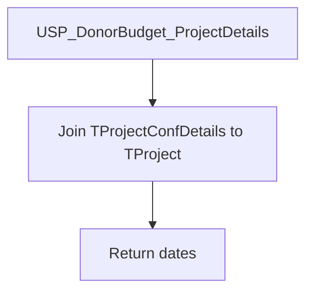

# USP_DonorBudget_ProjectDetails

## What it does

Returns project name, project code, and start/end dates for a project id and employer from `TProject` joined to `TProjectConfDetails`. Used to prefill budget-form project dates.

## Parameters

| Name | Direction | What it is for |
|---|---|---|
| `@ProjectID` | in | Project (`TProjectConfDetails.LookupID`) |
| `@EmployerID` | in | Employer on the config row |

## Call sequence

Calls no other procedures or functions.

## Callers

Application: Donor Information Setup `GetProjectDateDetails` (`recruitmentDAL.js`). No other procedure or function calls this object.

## Nested

Calls no other procedures or functions.

## Steps

1. Join `TProjectConfDetails` to `TProject` on `LookupID = ProjectID`.
2. Filter by `@ProjectID` and `@EmployerID`.
3. Return `ProjectName`, `ProjectCode`, `StartDate`, `EndDate`.

## Tables

| Table | Read or write |
|---|---|
| `TProjectConfDetails` | read |
| `TProject` | read |

## Unresolved calls

None.

## Flow

