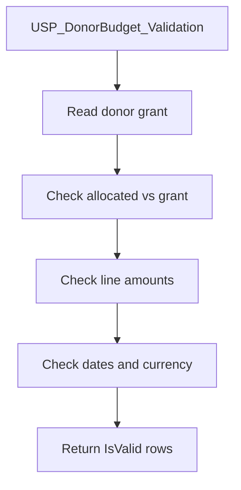

# USP_DonorBudget_Validation

## What it does

Validates a proposed budget against the donor’s grant before save. Checks cumulative allocated amount, sum of line budget amounts, budget period inside grant dates, and currency match. Returns validation rows (`IsValid`, `Message`).

## Parameters

| Name | Direction | What it is for |
|---|---|---|
| `@UDTDonorBudgetDetails` | in | Proposed line items |
| `@DonarId` | in | Donor whose grant is the ceiling |
| `@AllocatedAmountCurrencyID` | in | Proposed allocated currency |
| `@AllocatedAmount` | in | Proposed allocated amount for this save |
| `@BudgetStartDate` / `@BudgetEndDate` | in | Proposed budget period |

## Call sequence

Calls no other procedures or functions.

## Callers

Application: Donor Information Setup `InsertBudgetInformationValidation` (`recruitmentDAL.js`). No other procedure or function calls this object.

## Nested

Calls no other procedures or functions.

## Steps

1. Read donor grant amount, dates, and currency from `TDonarInfoMaster`.
2. Sum existing `TDonorBudget.AllocatedAmount` for the donor and add `@AllocatedAmount`; fail if over grant.
3. Sum UDT `BudgetAmount`; fail if over grant or over `@AllocatedAmount`.
4. Fail if budget dates fall outside grant dates or currencies disagree.
5. Return error rows or a single success row.

## Tables

| Table | Read or write |
|---|---|
| `TDonarInfoMaster` | read |
| `TDonorBudget` | read |
| `UDT_DonorBudgetDetails` | read (table type) |

## Unresolved calls

None.

## Flow

