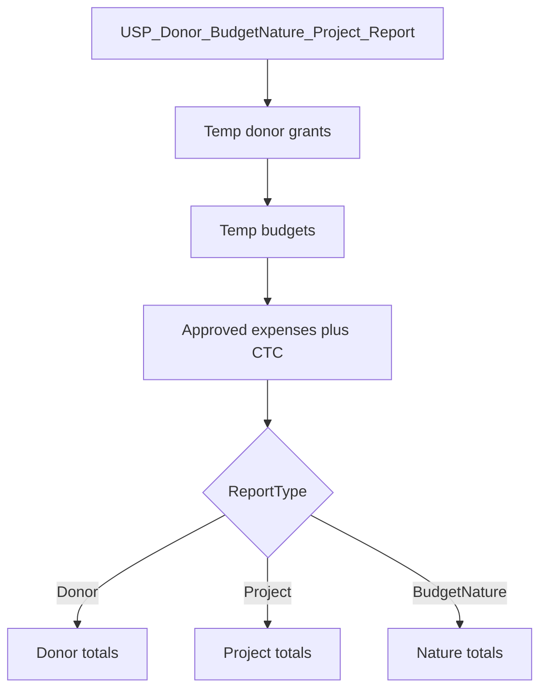

# USP_Donor_BudgetNature_Project_Report

## What it does

Builds donor / project / budget-nature utilization reports. Combines approved T&E expense amounts (`VE_TNE_ExpenseDetails` keyed by budget detail id) with employee CTC cost allocated through `TEmployeeBudgetSourceDetails`, then returns grant/allocated totals, utilized, and available amounts for the requested `@ReportType`.

## Parameters

| Name | Direction | What it is for |
|---|---|---|
| `@ReportType` | in | `Donor`, `Project`, or `BudgetNature` |
| `@DonorIDs` | in | Optional comma-separated donor filter |
| `@BudgetNatureIDs` | in | Optional comma-separated nature filter |
| `@ProjectIDs` | in | Optional comma-separated project filter |
| `@EmployerId` | in | Employer scope |

## Call sequence

Calls no other procedures or functions.

## Callers

Application: Donor Information Setup report tab `getDonorBudgetNatureProjectReport` (`recruitmentDAL.js`). No other procedure or function calls this object.

## Nested

Calls no other procedures or functions.

## Steps

1. Build `#DonorGrantAmount` from active `TDonarInfoMaster` for the filters.
2. Build `#DonorBudgets` from active `TDonorBudget` / `TDonorBudgetDetail`.
3. Collect approved expenses from `VE_TNE_ExpenseDetails` into `#ExpenseDetails`.
4. Compute employee CTC expense temp tables from `TEmployeeBudgetSourceDetails` + `TCTC`.
5. Branch on `@ReportType` and return donor-, project-, or nature-grain totals with utilized and available amounts.

## Tables

| Table | Read or write |
|---|---|
| `TDonarInfoMaster` | read |
| `TDonorBudget` | read |
| `TDonorBudgetDetail` | read |
| `VE_TNE_ExpenseDetails` | read |
| `TEmployeeBudgetSourceDetails` | read |
| `TEmployeeInfo` | read |
| `TEmployeeEmploymentType` | read |
| `TResignationDetails` | read |
| `TCTC` | read |
| `TLOOKUP` | read |

## Unresolved calls

None.

## Flow

