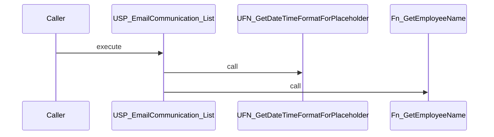
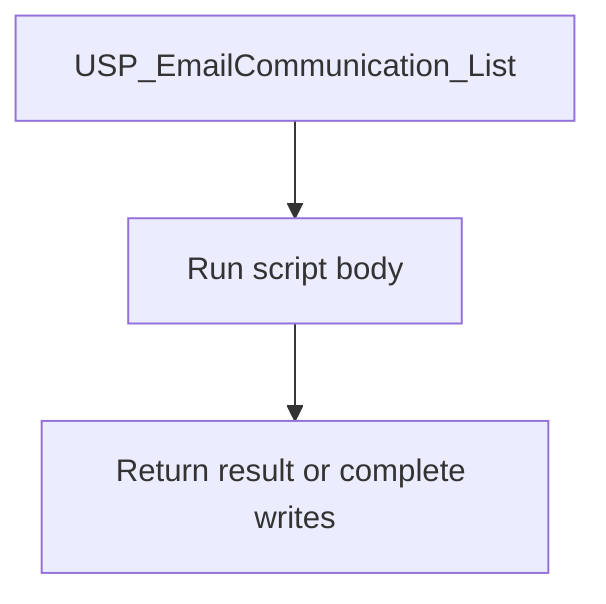

# USP_EmailCommunication_List

## What it does

Lists candidate email-communication rows for an employer, optionally filtered by candidate ids.

## Parameters

| Name | Direction | What it is for |
|---|---|---|
| `@EmployerId` | in | INT |
| `@EmailCommunicationID` | in | INT |
| `@CandidateIds` | in | VARCHAR |

## Call sequence

## Callers

Application callers include Core API `preOnBoardingDAL` methods used by **Employee Management → Pre-Onboarding Candidate** (`PreOnboardCandidate.aspx`). Search HRMS `STOREPROCEDURE/` and `FUNCTIONS/` for additional `EXEC`/`dbo.` callers when extending this page.

## Nested

| Object | Kind | When | Page |
|---|---|---|---|
| `UFN_GetDateTimeFormatForPlaceholder` | function | always when reached | [UFN_GetDateTimeFormatForPlaceholder](/docs/database/hrms/UFN_GetDateTimeFormatForPlaceholder) |
| `Fn_GetEmployeeName` | function | always when reached | [Fn_GetEmployeeName](/docs/database/hrms/Fn_GetEmployeeName) |

## Steps

From `HRMS-DATABASE/HRMS/STOREPROCEDURE/USP_EmailCommunication_List.sql`:

1. See script body for ordered statements.

## Tables

| Table | Read or write |
|---|---|
| `dbo.TEmailCommunication` | read |
| `dbo.POBCandidate` | read |

## Flow

