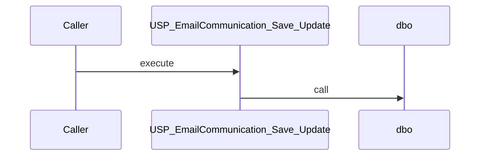
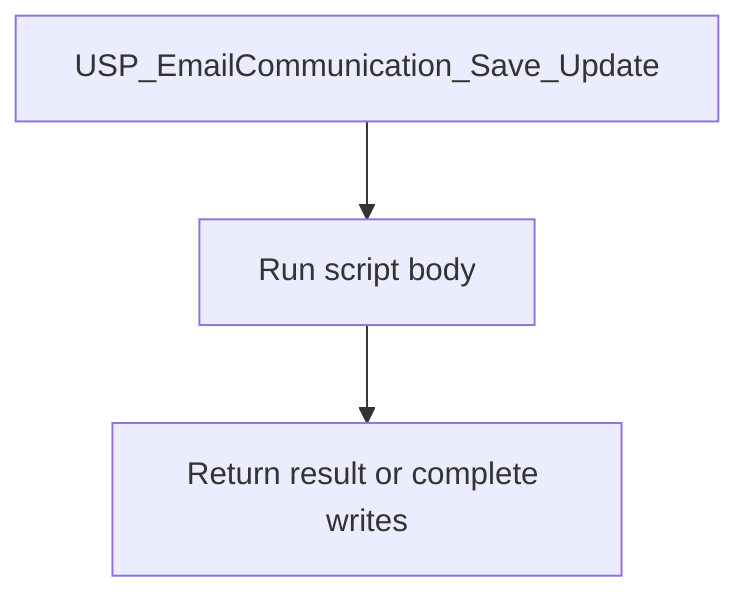

# USP_EmailCommunication_Save_Update

## What it does

Inserts or updates a candidate email-communication row.

## Parameters

| Name | Direction | What it is for |
|---|---|---|
| `@EmailCommunicationID` | in | INT |
| `@EmailTo` | in | VARCHAR |
| `@EmailSubject` | in | VARCHAR |
| `@EmailSent` | in | INT |
| `@EmailSentOn` | in | DATETIME |
| `@AttachmentPath` | in | VARCHAR |
| `@EmailCC` | in | VARCHAR |
| `@EmailBCC` | in | VARCHAR |
| `@EmailNotificationId` | in | INT |
| `@EmailBody` | in | NVARCHAR |
| `@EmailCreatedBy` | in | INT |
| `@EmailUpdatedBy` | in | INT |
| `@EmployerId` | in | INT |
| `@CandidateID` | in | INT |
| `@AttachmentName` | in | VARCHAR |

## Call sequence

## Callers

Application callers include Core API `preOnBoardingDAL` methods used by **Employee Management → Pre-Onboarding Candidate** (`PreOnboardCandidate.aspx`). Search HRMS `STOREPROCEDURE/` and `FUNCTIONS/` for additional `EXEC`/`dbo.` callers when extending this page.

## Nested

| Object | Kind | When | Page |
|---|---|---|---|
| `dbo` | procedure | always when reached | No page yet |

## Steps

From `HRMS-DATABASE/HRMS/STOREPROCEDURE/USP_EmailCommunication_Save_Update.sql`:

1. Executes `dbo`.

## Tables

| Table | Read or write |
|---|---|
| `dbo.TEmployerDetails` | read |
| `dbo.TEmail` | write |
| `dbo.TEmailCommunication` | write |

## Flow

