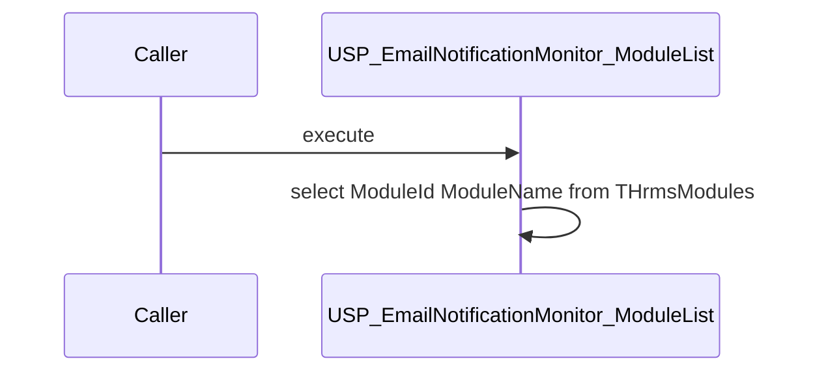
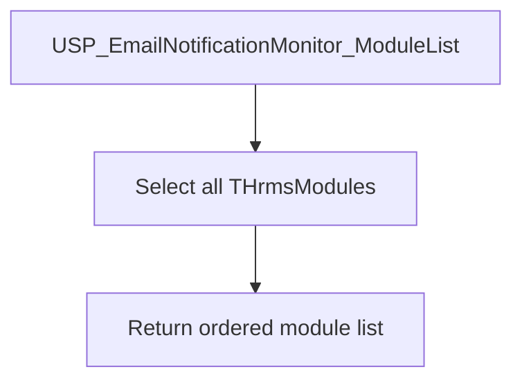

# USP_EmailNotificationMonitor_ModuleList

## What it does

Returns every `THrmsModules` row (`ModuleId`, `ModuleName`) ordered by `DisplayOrder` then `ModuleName`, for the Email Notification Monitor Module multi-select. The UI sends selected ids as `USP_EmailNotificationMonitor_Select` / `USP_EmailNotificationMonitor_SummaryCounts` `@ResolvedModuleId`. It does not filter on `IsActive` or `IsNotificationModule`.

## Parameters

| Name | Direction | What it is for |
|---|---|---|
| — | — | The procedure takes no parameters |

## Call sequence

## Callers

No other procedure or function calls this object. `dashBoardDAL.GetEmailNotificationMonitorModules` executes it from `GET /dashboard/GetEmailNotificationMonitorModules` for Email Notification Monitor.

## Nested

None. This procedure calls no other procedures or functions.

## Steps

1. In `HRMS-DATABASE/HRMS/STOREPROCEDURE/USP_EmailNotificationMonitor_ModuleList.sql`, select `ModuleId` and `ModuleName` from `dbo.THrmsModules`.
2. Order by `DisplayOrder`, then `ModuleName`.

## Tables

| Table | Read or write |
|---|---|
| `dbo.THrmsModules` | read |

## Unresolved calls

None.

## Flow

