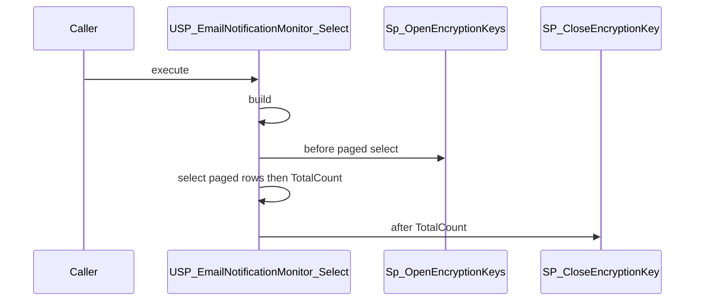
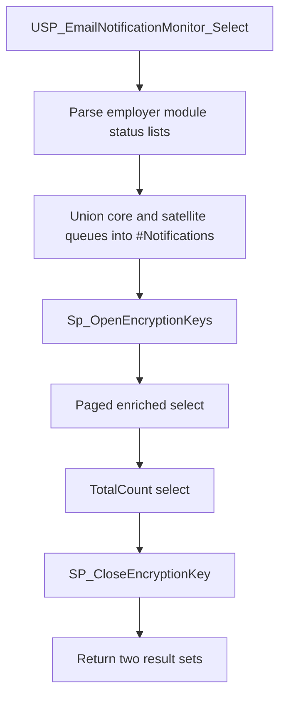

# USP_EmailNotificationMonitor_Select

## What it does

Returns a paged list of email-notification monitor rows for Admin Configuration → Email Notification Monitor, plus a second result set with `TotalCount` for the same filters without paging. It unions core `TEmailNotification` with the four satellite `TEMAIL_NOTIFICATION_*` queues, maps statuses to a unified `NotificationStatus`, attaches aggregated `TEmail` delivery and recipient fields, resolves module/page display through `TModulePages` / `THrmsModules`, and surfaces the latest `TFailedEmailNotificationLog` error for Failed rows. Both result sets keep only `Completed` and `Failed` after mapping.

## Parameters

| Name | Direction | What it is for |
|---|---|---|
| `@Module` | in | Physical source branch filter: `CORE`, `TIMEPORT`, `TRAINING`, `RESOURCEALLOCATION`, `SURVEY`, `TRAVELNEXPENSE`, or `ALL` (default `ALL`) |
| `@ResolvedModuleId` | in | Optional comma-separated `THrmsModules.ModuleId` list; null/empty means no business-module restriction |
| `@CreatedDateFrom` | in | Optional created-date lower bound; both from and to must be set for the date filter to apply |
| `@CreatedDateTo` | in | Optional created-date upper bound |
| `@Status` | in | Optional comma-separated unified statuses; null/empty means no extra status list beyond the Completed/Failed hard filter |
| `@EmailSentOnly` | in | When `1`, keep only rows with `EmailSent = 1` on the paged result; not applied to `TotalCount` |
| `@EmployerIds` | in | Optional comma-separated employer ids the caller may see; null/empty means unrestricted |
| `@PageNumber` | in | Zero-based page index (default coerced to `0`) |
| `@PageSize` | in | Page size (default `50`, capped at `500`) |

## Call sequence

## Callers

No other procedure or function calls this object. `dashBoardDAL.GetEmailNotificationMonitor` executes it from `POST /dashboard/GetEmailNotificationMonitor` for Email Notification Monitor.

## Nested

| Object | Kind | When | Page |
|---|---|---|---|
| `Sp_OpenEncryptionKeys` | procedure | immediately before the paged result select | [Sp_OpenEncryptionKeys](/docs/database/hrms/Sp_OpenEncryptionKeys) |
| `SP_CloseEncryptionKey` | procedure | after the TotalCount select | [SP_CloseEncryptionKey](/docs/database/hrms/SP_CloseEncryptionKey) |

## Steps

1. In `HRMS-DATABASE/HRMS/STOREPROCEDURE/USP_EmailNotificationMonitor_Select.sql`, coerce `@PageNumber` to a non-negative value and `@PageSize` into `1..500` (default `50`).
2. Parse `@EmployerIds`, `@ResolvedModuleId`, and `@Status` with `string_split` into temp key tables when non-empty.
3. Build `#Notifications` from `TEmailNotification` (CORE/TIMEPORT/ALL) with an outer apply aggregate on `TEmail` by `EmailNotificationId`.
4. Insert satellite rows from `TEMAIL_NOTIFICATION_TRAINING`, `TEMAIL_NOTIFICATION_RESOURCEALLOCATION`, `TEMAIL_NOTIFICATION_SURVEY`, and `TEMAIL_NOTIFICATION_TRAVELNEXPENSE`, each joining `TEmail` on id plus a `CreatedOn`..`EditedOn` window.
5. Execute `Sp_OpenEncryptionKeys`.
6. Select the paged grid columns: employer name, resolved module/page, recipients, mapped status, Failed-only error text from `TFailedEmailNotificationLog` (fallback to core `ErrorDetails`), and employee display names from `TEmployee`.
7. Apply status list / Completed-Failed hard filter / optional `@EmailSentOnly` / module / employer filters, order by `CreatedDate` desc, then `OFFSET`/`FETCH`.
8. Select `TotalCount` with the same filters except `@EmailSentOnly` and paging.
9. Execute `SP_CloseEncryptionKey`.

## Tables

| Table | Read or write |
|---|---|
| `dbo.TEmailNotification` | read |
| `dbo.TEMAIL_NOTIFICATION_TRAINING` | read |
| `dbo.TEMAIL_NOTIFICATION_RESOURCEALLOCATION` | read |
| `dbo.TEMAIL_NOTIFICATION_SURVEY` | read |
| `dbo.TEMAIL_NOTIFICATION_TRAVELNEXPENSE` | read |
| `dbo.TEmail` | read |
| `dbo.TFailedEmailNotificationLog` | read |
| `dbo.TEmployerDetails` | read |
| `dbo.TModulePages` | read |
| `dbo.THrmsModules` | read |
| `dbo.TEmployee` | read |

## Unresolved calls

None.

## Flow

