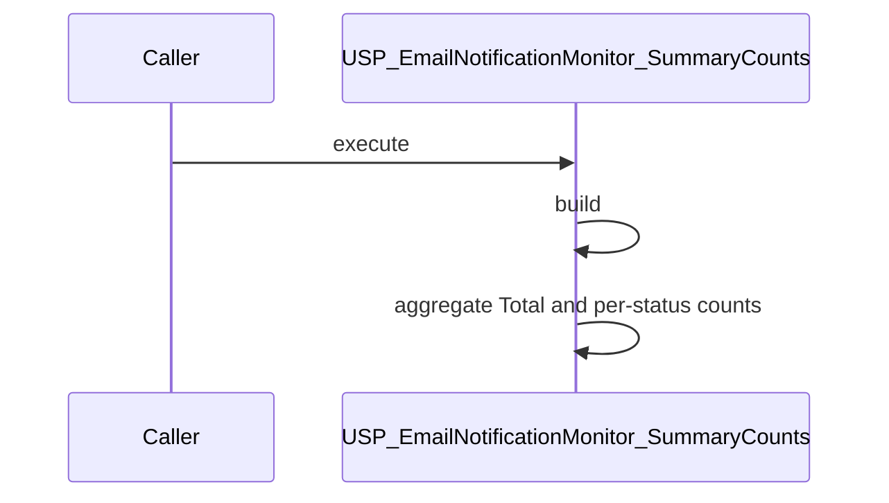
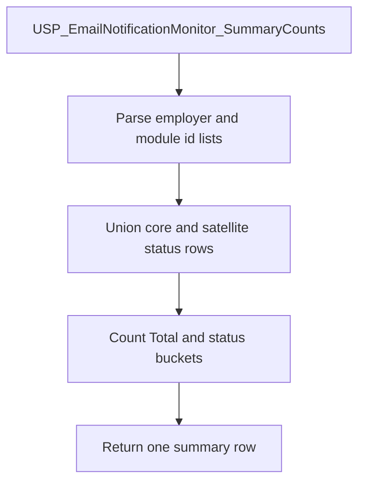

# USP_EmailNotificationMonitor_SummaryCounts

## What it does

Returns one summary row for the Email Notification Monitor status chip bar: `Total` plus counts per unified `NotificationStatus` (`New`, `Pending`, `Failed`, `Completed`, `Under Review`, `Other`). It uses the same physical-source union and status mapping as `USP_EmailNotificationMonitor_Select`, with the same `@Module`, `@ResolvedModuleId`, created-date, and `@EmployerIds` filters. It deliberately has no `@Status` parameter so totals always span every mapped status.

## Parameters

| Name | Direction | What it is for |
|---|---|---|
| `@Module` | in | Physical source branch filter: `CORE`, `TIMEPORT`, `TRAINING`, `RESOURCEALLOCATION`, `SURVEY`, `TRAVELNEXPENSE`, or `ALL` (default `ALL`) |
| `@ResolvedModuleId` | in | Optional comma-separated `THrmsModules.ModuleId` list; null/empty means no business-module restriction |
| `@CreatedDateFrom` | in | Optional created-date lower bound; both from and to must be set for the date filter to apply |
| `@CreatedDateTo` | in | Optional created-date upper bound |
| `@EmployerIds` | in | Optional comma-separated employer ids the caller may see; null/empty means unrestricted |

## Call sequence

## Callers

No other procedure or function calls this object. `dashBoardDAL.GetEmailNotificationMonitorSummaryCounts` executes it from `POST /dashboard/GetEmailNotificationMonitorSummaryCounts` for Email Notification Monitor.

## Nested

None. This procedure calls no other procedures or functions.

## Steps

1. In `HRMS-DATABASE/HRMS/STOREPROCEDURE/USP_EmailNotificationMonitor_SummaryCounts.sql`, parse `@EmployerIds` and `@ResolvedModuleId` into temp key tables when non-empty.
2. Insert mapped core rows from `TEmailNotification` into `#Notifications` when `@Module` is `CORE`, `TIMEPORT`, or `ALL` (core `Review` maps to `Failed`).
3. Insert mapped satellite rows from the four `TEMAIL_NOTIFICATION_*` tables for their matching `@Module` / `ALL` branches.
4. Left join `TModulePages` and `THrmsModules` on `TemplateName` / `ModulePageName` when filtering by resolved module ids.
5. Return one row with `Total` and the six status count columns for rows that pass the employer and resolved-module filters.

## Tables

| Table | Read or write |
|---|---|
| `dbo.TEmailNotification` | read |
| `dbo.TEMAIL_NOTIFICATION_TRAINING` | read |
| `dbo.TEMAIL_NOTIFICATION_RESOURCEALLOCATION` | read |
| `dbo.TEMAIL_NOTIFICATION_SURVEY` | read |
| `dbo.TEMAIL_NOTIFICATION_TRAVELNEXPENSE` | read |
| `dbo.TModulePages` | read |
| `dbo.THrmsModules` | read |

## Unresolved calls

None.

## Flow

