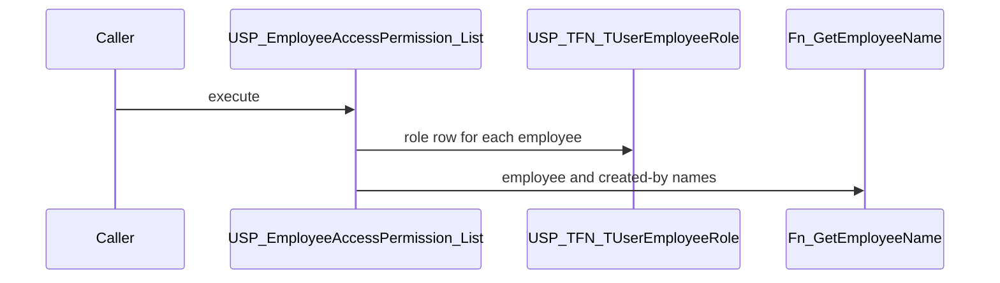
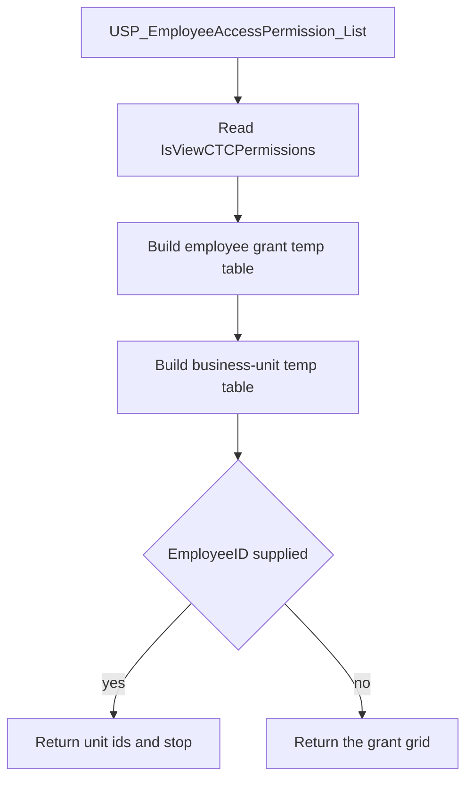

# USP_EmployeeAccessPermission_List

## What it does

Lists employee CTC grants for an employer, with each employee's business-unit summary. When `@EmployeeID` is supplied it returns a shorter unit list instead of the grid, and that short list depends on the parent's `IsViewCTCPermissions` flag.

## Parameters

| Name | Direction | What it is for |
|---|---|---|
| `@EmployerID` | in | Organisation |
| `@EmployeeAccessPermissionID` | in | Optional single grant |
| `@EmployeeID` | in | Optional employee. Changes the result shape |

## Call sequence

## Callers

No other procedure or function calls this object.

`dashBoardDAL.GetCTCAccessEmployeeData` calls it from Recruitment Management.

## Nested

| Object | Kind | When | Page |
|---|---|---|---|
| `USP_TFN_TUserEmployeeRole` | function | once per employee grant, through `OUTER APPLY` | [USP_TFN_TUserEmployeeRole](/docs/database/hrms/USP_TFN_TUserEmployeeRole) |
| `Fn_GetEmployeeName` | function | employee name and created-by name | [Fn_GetEmployeeName](/docs/database/hrms/Fn_GetEmployeeName) |
| `UFN_GetDateTimeFormatForPlaceholder` | function | formats `CreatedWhen` | [UFN_GetDateTimeFormatForPlaceholder](/docs/database/hrms/UFN_GetDateTimeFormatForPlaceholder) |

## Steps

1. Resolve `@IsViewCTCPermissions` from `TCustomerSettings`. A child employer uses the parent employer's flag (`USP_EmployeeAccessPermission_List.sql`).
2. Build `#EmployeeAccessPermission` from `TEmployeeAccessPermission` joined to `TEmployeeInfo`, active business units, and `USP_TFN_TUserEmployeeRole`.
3. Build `#EmployeeBUList` from active `TEmployeeBUPermission` rows joined to organisation units and employer names.
4. When `@EmployeeID` is not null, return active unit ids when the CTC flag is 1, or every active unit of the employer when the flag is 0, then `RETURN`.
5. Otherwise aggregate unit names and ids per grant and return the grid ordered by `EmployeeAccessPermissionID` descending.

## Tables

| Table | Read or write |
|---|---|
| `TCustomerSettings` | read |
| `TEmployerDetails` | read |
| `TEmployeeAccessPermission` | read |
| `TEmployeeInfo` | read |
| `TOrgHierarchyDetails` | read |
| `TEmployeeBUPermission` | read |

## Flow

