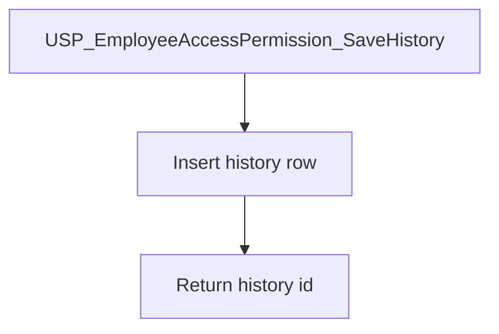

# USP_EmployeeAccessPermission_SaveHistory

## What it does

Copies one `TEmployeeAccessPermission` row into `TEmployeeAccessPermissionHistory` and returns the new history id.

## Parameters

| Name | Direction | What it is for |
|---|---|---|
| `@EmployeeAccessPermissionID` | in | Employee grant to copy |
| `@EmployeeAccessPermissionHistoryID` | out | New `TEmployeeAccessPermissionHistory` identity |

## Call sequence

Calls no other procedures or functions.

## Callers

| Object | Kind | Page |
|---|---|---|
| `USP_Permission_SaveUpdate` | procedure | [USP_Permission_SaveUpdate](/docs/database/hrms/USP_Permission_SaveUpdate) |
| `USP_EmployeeAccessPermission_SaveUpdate` | procedure | [USP_EmployeeAccessPermission_SaveUpdate](/docs/database/hrms/USP_EmployeeAccessPermission_SaveUpdate) |

## Nested

Calls no other procedures or functions.

## Steps

1. Insert into `TEmployeeAccessPermissionHistory` the permission, employer, role, employee, module, CTC flag, active flag, and audit columns from `TEmployeeAccessPermission` (`USP_EmployeeAccessPermission_SaveHistory.sql`).
2. Set the output parameter from `SCOPE_IDENTITY()`.

## Tables

| Table | Read or write |
|---|---|
| `TEmployeeAccessPermission` | read |
| `TEmployeeAccessPermissionHistory` | write |

## Flow

