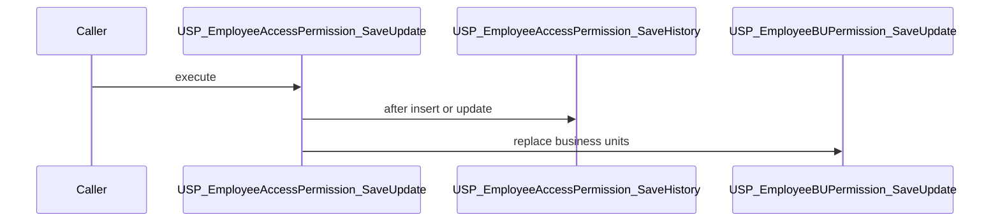
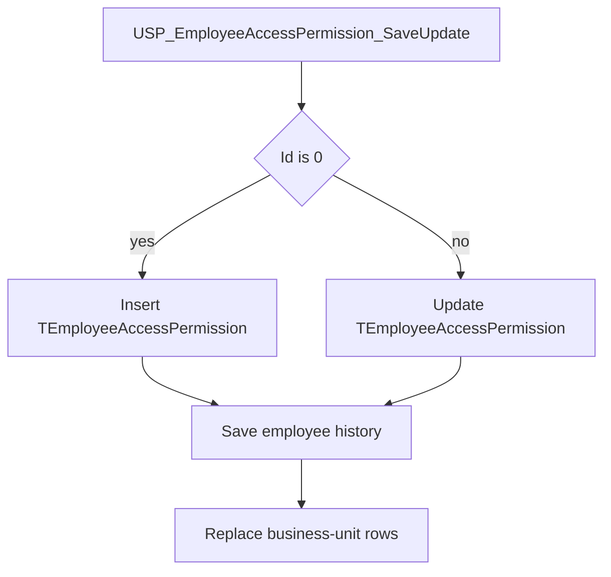

# USP_EmployeeAccessPermission_SaveUpdate

## What it does

Inserts or updates one employee CTC-access row, writes its history, then replaces that row's business-unit list from a comma-separated string.

## Parameters

| Name | Direction | What it is for |
|---|---|---|
| `@EmployeeAccessPermissionID` | in | 0 inserts. Any other value updates that row |
| `@PermissionID` | in | Parent role permission |
| `@EmployerID` | in | Organisation |
| `@RoleID` | in | Role |
| `@EmployeeID` | in | Employee who receives the grant |
| `@ModuleID` | in | Module |
| `@CanShowCTC` | in | CTC visibility |
| `@EmployeeBU` | in | Comma-separated business-unit ids |
| `@CreatedBy` | in | Actor |
| `@IsActive` | in | Active flag |

## Call sequence

## Callers

No other procedure or function calls this object.

`dashBoardDAL.SaveCTCAccessPermissionEmployee` calls it from Recruitment Management.

## Nested

| Object | Kind | When | Page |
|---|---|---|---|
| `USP_EmployeeAccessPermission_SaveHistory` | procedure | after the insert or update | [USP_EmployeeAccessPermission_SaveHistory](/docs/database/hrms/USP_EmployeeAccessPermission_SaveHistory) |
| `USP_EmployeeBUPermission_SaveUpdate` | procedure | after history, with the new history id | [USP_EmployeeBUPermission_SaveUpdate](/docs/database/hrms/USP_EmployeeBUPermission_SaveUpdate) |

## Steps

1. When `@EmployeeAccessPermissionID` is null or 0, insert `TEmployeeAccessPermission` and set the id from `SCOPE_IDENTITY()` (`USP_EmployeeAccessPermission_SaveUpdate.sql`).
2. Otherwise update permission, employer, role, module, CTC flag, active flag, and audit columns.
3. `EXEC USP_EmployeeAccessPermission_SaveHistory` and capture `@EmployeeAccessPermissionHistoryID`.
4. `EXEC USP_EmployeeBUPermission_SaveUpdate` with `@EmployeeBU`.

## Tables

| Table | Read or write |
|---|---|
| `TEmployeeAccessPermission` | write |

## Flow

