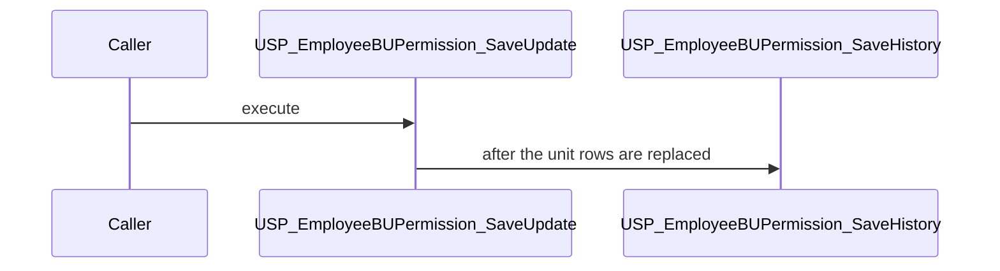
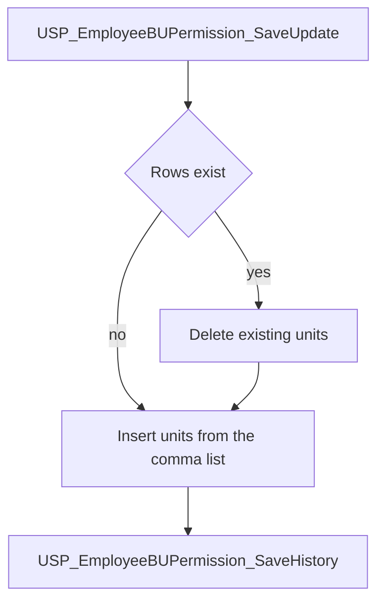

# USP_EmployeeBUPermission_SaveUpdate

## What it does

Deletes the business-unit rows for one employee CTC grant and inserts a fresh active row for each distinct value in a comma-separated list. It then asks the history procedure to snapshot those units.

## Parameters

| Name | Direction | What it is for |
|---|---|---|
| `@EmployeeAccessPermissionID` | in | Employee grant whose units are replaced |
| `@EmployeeBU` | in | Comma-separated business-unit ids |
| `@CreatedBy` | in | Actor |
| `@EmployeeAccessPermissionHistoryID` | in | History id passed through to the snapshot |

## Call sequence

## Callers

| Object | Kind | Page |
|---|---|---|
| `USP_Permission_SaveUpdate` | procedure | [USP_Permission_SaveUpdate](/docs/database/hrms/USP_Permission_SaveUpdate) |
| `USP_EmployeeAccessPermission_SaveUpdate` | procedure | [USP_EmployeeAccessPermission_SaveUpdate](/docs/database/hrms/USP_EmployeeAccessPermission_SaveUpdate) |

## Nested

| Object | Kind | When | Page |
|---|---|---|---|
| `USP_EmployeeBUPermission_SaveHistory` | procedure | after the delete and insert | No page yet |

## Steps

1. When `TEmployeeBUPermission` already has rows for the employee grant, delete them (`USP_EmployeeBUPermission_SaveUpdate.sql`).
2. Insert one active row per distinct value from `STRING_SPLIT(@EmployeeBU, ',')`.
3. `EXEC USP_EmployeeBUPermission_SaveHistory`.

## Tables

| Table | Read or write |
|---|---|
| `TEmployeeBUPermission` | write |

## Flow

