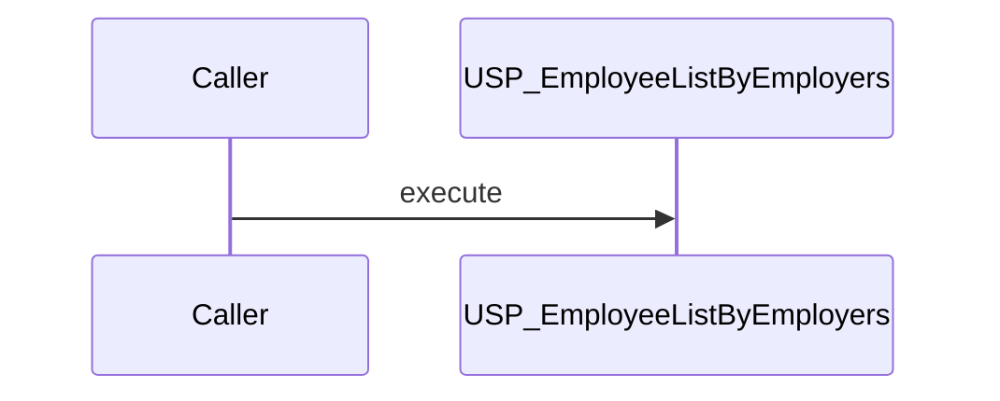
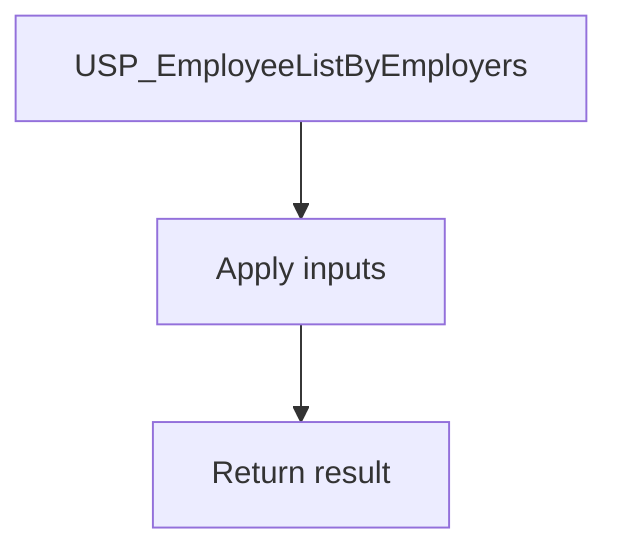

# USP_EmployeeListByEmployers

## What it does

Employee picker for Compliance Report. TimePort DAL runs it on the core connection with login employee, employer CSV, optional BU, and include-approver flag.

## Parameters

| Name | Direction | What it is for |
|---|---|---|
| `@EmployerId` | in | Primary employer |
| `@LoginEmployeeId` | in | Login employee (JWT) |
| `@BusinessUnit` | in | Optional BU CSV |
| `@pEmployerIds` | in | Employer CSV |
| `@pIncludeApprover` | in | Include approver flag |

## Call sequence

## Callers

| Object | Kind | Page |
|---|---|---|
| `_application_` | TimePort API | [Report guide](/docs/guides/timeport/report) |

## Nested

| Object | Kind | When | Page |
|---|---|---|---|
| `Sp_OpenEncryptionKeys` | procedure | start | [Sp_OpenEncryptionKeys](/docs/database/hrms/Sp_OpenEncryptionKeys) |

## Steps

In `HRMS-DATABASE/HRMS/STOREPROCEDURE/USP_EmployeeListByEmployers.sql`:

1. Open encryption keys.
2. Select employees for the employer list with optional BU / approver inclusion.
3. Return employee id/name rows for the picker.

## Tables

| Table | Read or write |
|---|---|
| `TEmployee` | read |
| `TEmployerDetails` | read |
| `TEmployeeInfo` | read |

## Flow

