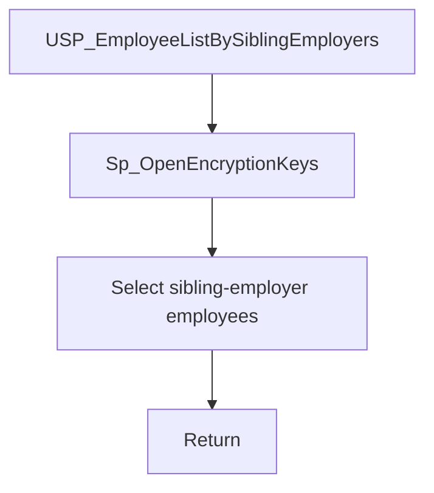

# USP_EmployeeListBySiblingEmployers

## What it does

Lists employees across sibling employers of the given employer (org picker seed for Manage Allocation).

## Parameters

| Name | Direction | What it is for |
|---|---|---|
| `@EmployerId` | in | Starting employer |
| `@LoginEmployeeId` | in | Optional logged-in employee |

## Call sequence

`EXECUTE Sp_OpenEncryptionKeys` then select employee rows.

## Callers

RA WebAPI `employeeDAL.GetEmployeeListByOrg` (synonym) from [Manage Allocation](/docs/guides/resource-allocation/manage-allocation).

## Nested

`Sp_OpenEncryptionKeys`.

## Steps

1. Open encryption keys.
2. Select employees under sibling employers of `@EmployerId`.

## Tables

| Table | Read or write |
|---|---|
| `dbo.TEmployerDetails` | read |
| `dbo.TEmployee / TEmployeeInfo` | read |

## Unresolved calls

None.

## Flow

