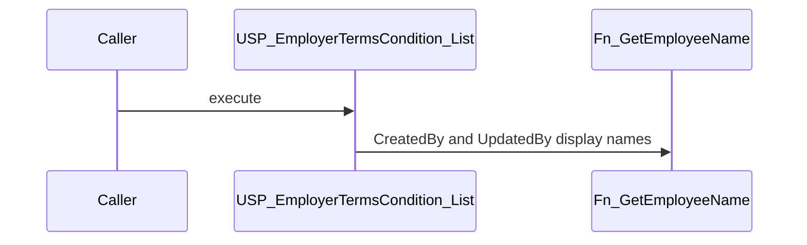
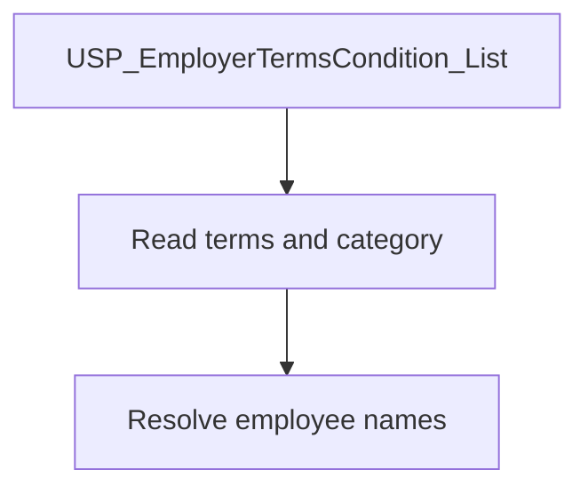

# USP_EmployerTermsCondition_List

## What it does

Returns employer terms-and-conditions rows with category name and creator or updater display names.

## Parameters

| Name | Direction | What it is for |
|---|---|---|
| `@EmployerID` | in | Employer whose terms are listed |

## Call sequence

## Callers

No other procedure or function calls this object.

## Nested

| Object | Kind | When | Page |
|---|---|---|---|
| `Fn_GetEmployeeName` | function | for CreatedBy and UpdatedBy | [Fn_GetEmployeeName](/docs/database/hrms/Fn_GetEmployeeName) |

## Steps

1. Select terms rows from `TEmployerTermsCondition` for `@EmployerID`.
2. Join `Temployeedetail_Category` for category name.
3. Resolve employee names through `Fn_GetEmployeeName`.

## Tables

| Table | Read or write |
|---|---|
| `TEmployerTermsCondition` | read |
| `Temployeedetail_Category` | read |

## Flow

