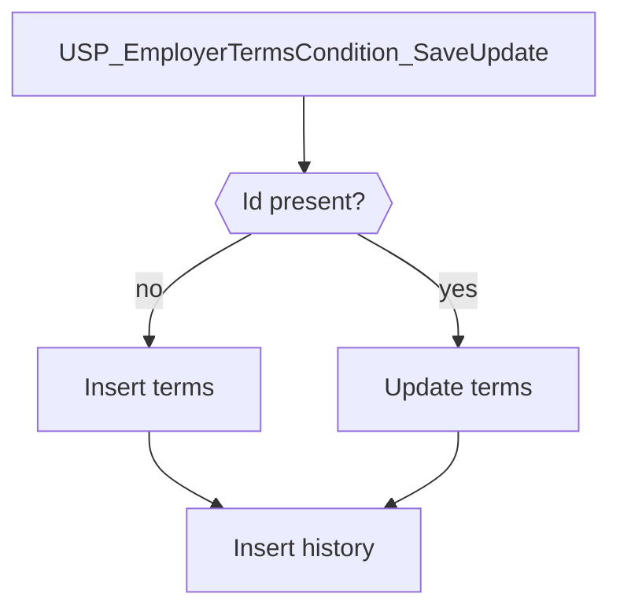

# USP_EmployerTermsCondition_SaveUpdate

## What it does

Inserts or updates employer terms-and-conditions text for a category, then writes a history row.

## Parameters

| Name | Direction | What it is for |
|---|---|---|
| `@EmployerTermsConditionID` | in | Existing id, or 0 or null to insert |
| `@EmployerID` | in | Employer |
| `@TermsAndCondition` | in | Terms HTML or text |
| `@TCategoryID` | in | Category |
| `@CreatedBy` | in | Creator on insert |
| `@UpdatedBy` | in | Updater on update |

## Call sequence

Calls no other procedures or functions.

## Callers

No other procedure or function calls this object.

## Nested

Calls no other procedures or functions.

## Steps

1. When `@EmployerTermsConditionID` is null or 0, insert into `TEmployerTermsCondition` and capture the new id.
2. Otherwise update the existing row and set `@CreatedBy` to `@UpdatedBy` for history.
3. Insert a matching row into `TEmployerTermsConditionHistory`.

## Tables

| Table | Read or write |
|---|---|
| `TEmployerTermsCondition` | write |
| `TEmployerTermsConditionHistory` | write |

## Flow

