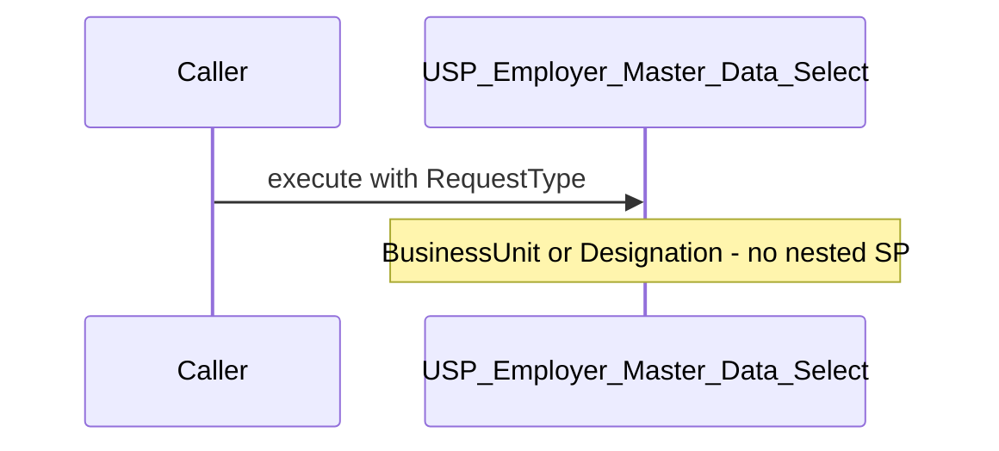
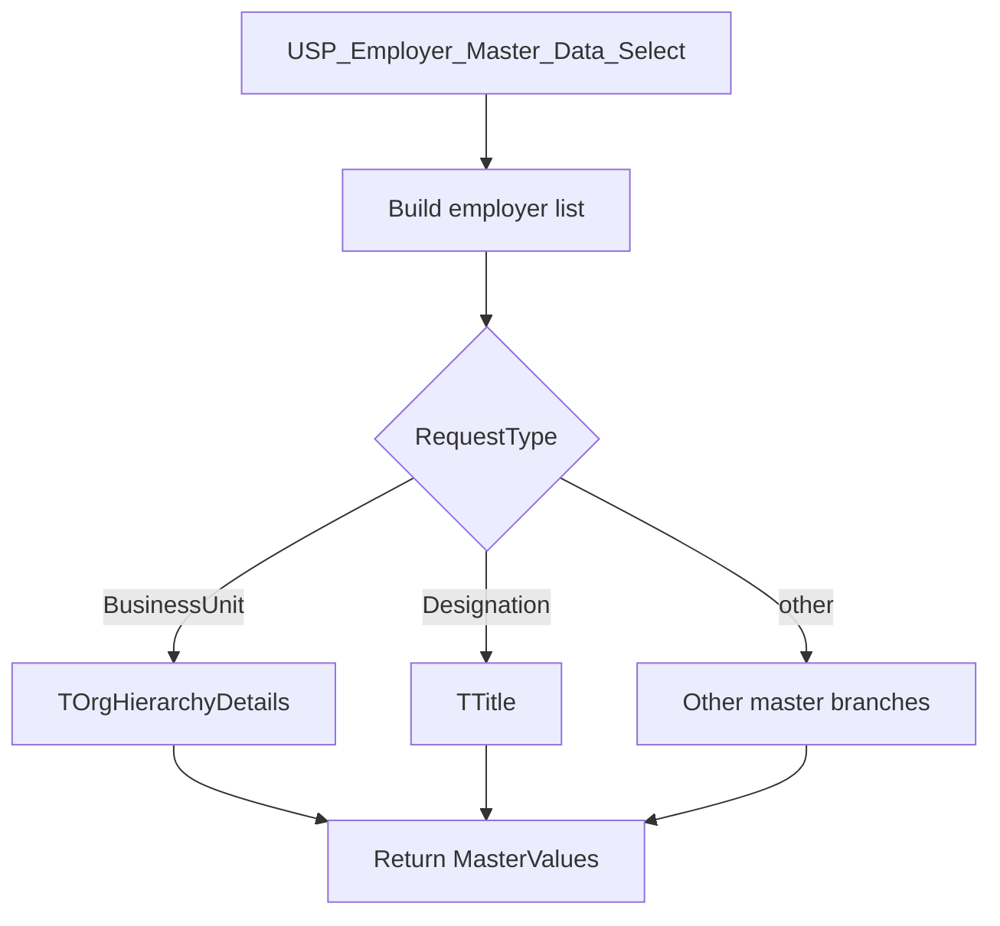

# USP_Employer_Master_Data_Select

## What it does

Employer master-data lookup driven by `@RequestType`. Returns id/name rows (and optional parent/employer columns) into a shared result shape. Feedback360 uses `BusinessUnit` (org hierarchy tree with `ParentUnitID`) and `Designation` (active titles). Other request types (locations, roles, grades, workflow trees, employee search, …) serve Report Builder and unrelated screens.

## Parameters

| Name | Direction | What it is for |
|---|---|---|
| `@EmployerID` | in | Primary employer id |
| `@RequestType` | in | Which master set to return (e.g. `BusinessUnit`, `Designation`) |
| `@SearchText` | in | Optional search text for search-style request types |
| `@EmployerIDs` | in | Optional CSV of employers; defaults to `@EmployerID` |
| `@ActiveStatus` | in | Optional active filter for search request types |
| `@Organizationunitid` | in | Optional org-unit filter CSV |
| `@WorkLocationid` | in | Optional work-location filter CSV |
| `@BaseLocationid` | in | Optional base-location filter CSV |
| `@DesignationID` | in | Optional designation filter CSV |
| `@EmploymentstatusID` | in | Optional employment-status filter CSV |
| `@RoleID` | in | Optional role filter CSV |

## Call sequence

For `BusinessUnit` and `Designation` (Feedback360 paths) the procedure calls no nested procedures. Some other `@RequestType` values call `SP_CM_GetWorkflowTreeXmlDetailsByPageTitle`.

## Callers

Application caller: Core API `Feedback360DAL.GetBusinessUnitHierarchy` / `GetDesignationMaster` for Performance Assessment → 360° Feedback (`Feedback360.aspx`). Also used by Reports and other master pickers.

| Object | Kind | Page |
|---|---|---|
| _(application)_ | Core API | [360° Feedback guide](/docs/guides/performance-assessment/360-feedback) |

## Nested

| Object | Kind | When | Page |
|---|---|---|---|
| `SP_CM_GetWorkflowTreeXmlDetailsByPageTitle` | procedure | claim/overtime workflow request types only | — |

Feedback360 does not hit those branches.

## Steps

1. Build `#EmployerList` from `@EmployerIDs` or `@EmployerID`.
2. Branch on `@RequestType`.
3. For `BusinessUnit` — select active, non-deleted `TOrgHierarchyDetails` units with `ParentUnitID`.
4. For `Designation` — select active `TTitle` rows for the employer list.
5. Return `#MasterValues` (ID, Name, RequestType, ParentUnitID, …).
6. Script path: `HRMS-DATABASE/HRMS/STOREPROCEDURE/USP_Employer_Master_Data_Select.sql`.

## Tables

| Table | Read or write |
|---|---|
| `dbo.TOrgHierarchyDetails` | read (`BusinessUnit`) |
| `dbo.TTitle` | read (`Designation`) |
| Other masters (`TLocation`, `TEmployeeRoleMaster`, …) | read (other request types) |

## Flow

